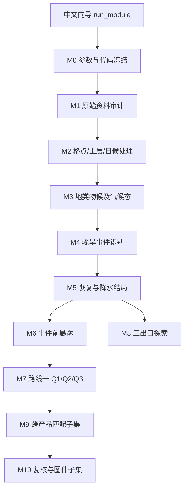

# 代码架构与运行文件完整说明

本说明依据2026-11-17工作区实际源码生成，覆盖生产脚本、调度层、配置、测试及调试脚本。它是一份代码阅读和运行指南，不是最终科学验收报告。下方函数说明来自当前源码；同名Markdown可能保留早期描述，发生冲突时应检查实际调用路径及最新收尾说明。

## 1. 先理解程序如何工作

整个项目是一条加工流水线：原始遥感和气象资料 → 统一格点与候尺度 → 识别骤旱 → 判断恢复与极端降水接续 → 连接事件前植被和深层水 → 统计分析。前面的模块生产数据，后面的模块读取冻结交接表；不能只凭某个脚本能运行，就认定整条科学分析已经验收。



此图突出处理顺序，精确依赖以文末DAG表为准。M7不依赖M8；M8可独立退出，不影响路线一。

## 2. 目录分别存放什么

| 目录/文件 | 内容 | 使用原则 |
| --- | --- | --- |
| config/params.yaml | 科学阈值、时间、随机种子、模型及敏感性设置 | 修改会改变冻结身份，不能同别名偷偷换参数 |
| config/schema_registry.yaml | 输出表列名及主键 | 判断交接表是否合规，不只是供阅读的字典 |
| config/specification_matrix.yaml | 产品、规范变体、敏感性登记 | 面板选项由登记驱动 |
| config/deviation_log.csv | 协议偏离及修订理由 | 已见结果后的修改如实登记，不伪装成预注册 |
| workflow/ | 运行计划、冻结、调度、进度与继承 | 用户从这里进入，不逐个直接执行科学脚本 |
| src/M0–M10/ | 科学数据处理和统计函数 | 每个脚本通常有同名说明文件 |
| src/MX/ | 运行清理维护工具 | 不属于科学分析，删除前须明确范围 |
| data/raw/ | 原始产品 | 只读，不能清理为临时文件 |
| data/interim/ | 中间处理数据 | 是否可重建取决于登记及依赖关系 |
| data/frozen/ | 冻结交接数据及回执 | 不覆盖；被继承引用时不可删除 |
| metadata/ | 数据、研究区、运行身份等登记 | 本机资料和数值审计放metadata/local/ |
| outputs/ | 表、图、模型摘要、报告 | 按运行别名隔离，历史结果保留 |
| logs/ | 模块状态、运行回执、冻结快照和日志 | 排查失败先看这里 |
| tests/ | 合成、单元和部分实文件测试 | pytest通过不等于所有科学结果验收通过 |
| notebooks/ | 数值审计和开发诊断脚本 | 不是正式生产入口；结果不能混作正式版本 |
| .venv/ | 项目Python环境 | 使用这里的解释器，避免系统Python版本错配 |
| __pycache__/ | Python自动字节码缓存 | 不属于科学源码，不在本说明中逐一列出 |

## 3. 用户实际怎样运行

在PowerShell切换到项目根目录，然后启动唯一推荐的交互入口：

```powershell
Set-Location F:\fdwt-loess-recovery
.\.venv\Scripts\python.exe -m workflow.run_module
```

1. 新运行先选择M0，输入新的运行别名，选择产品与分析方案，核对后正式冻结。仅完成预检不等于已冻结。
2. 冻结后选择指定模块M7，使用同一别名和同一方案。程序按依赖关系处理M1–M7；已经通过且哈希一致的结果可复用。
3. 5/5选择`main`，4/5选择`lai_four_of_five`。两者均为事件前五年窗口，后者允许其中四年有效，不是改成四年时间窗。两方案必须分别冻结，不在同一个别名内切换。
4. 需要仅跑修订M7时，应先通过统一Python入口准备只读上游继承；目前面板不能直接创建继承关系。准备后在面板选新别名M7即可。继承不复制大型表，不能删除来源运行。
5. 最后确认页核对模块顺序、数据组合、方案、别名和资源预算，再开始。运行时不要编辑正在使用的冻结配置。

**特别注意：`route1`在DAG里指向M10，不是“只跑到M7”。当前只需要M0–M7时，应选择指定模块M7。** `full`还包括M8。M8–M10目前是实现子集，不能因为目标名称叫完整工作流就假定全部科学分析完成。

代码检查命令：

```powershell
.\.venv\Scripts\python.exe -m pytest -q
```

这是测试，不是正式数据分析。`--dry-run`只检查计划，也不能替代数据验收。Snakemake文件已存在，但DAG试运行尚未验收，不作为当前推荐启动方式。

## 4. 各模块的输入、任务与产物

| 模块 | 主要输入 | 实际任务 | 核心产物/后续用途 |
| --- | --- | --- | --- |
| M0 | 配置、协议、资料登记、代码 | 冻结前审计；记录参数和代码身份 | 冻结快照、run_id、运行登记 |
| M1 | ERA5-Land原始文件 | 检查变量、时间、网格、覆盖与输入可用性 | 原始资料审计与来源记录 |
| M2 | 通过审计的ERA5-Land | 累计量处理、日/候转换、根区/深层与空间格点处理 | 格点日/候基础表及格点空间块 |
| M3 | M2表、MCD12Q1/Q2或已登记grid_support | 地类掩膜、当年/回退物候、独立气候态分位数 | grid_mask、grid_phenology、grid_climatology、grid_pentad |
| M4 | M3候序列 | 骤旱识别、持续条件、删失、区域连通 | event_master_base、候选审计与区域事件 |
| M5 | 事件和候序列 | 恢复轨迹、RT/幅度/速率、FR/FZ及湿过程 | event_master、分支表、恢复轨迹及超级块诊断 |
| M6 | M3–M5和MODIS/土壤/地形 | LAI原生QC、年聚合、事件前五年暴露与深层水连接 | event_exposure及缺失/完整性审计 |
| M7 | 路线一事件、暴露、候序列、分块 | Q1/Q2/Q3主模型、诊断及已接入补充 | 风险人候表、模型清单、系数、边际量、区间与敏感性表 |
| M8 | M3–M5，可选M6 | 三出口编码、门槛、描述性累计发生率及原因别时间基线 | 出口、风险人候、门槛和时间基线点估计 |
| M9 | 事件及已登记替代产品表 | 已实现格点事件一对一匹配及部分规范登记 | 匹配结果与规范清单；不等于自动完成跨产品重算 |
| M10 | 冻结交接及上游结果 | 交接审计、部分事件复核、表图导出 | 样本流、复核报告与图件子集 |

## 5. M7内部怎样分工

Q1回答恢复多快、恢复曲线怎样变化；Q2回答极端降水是否接续、接续时序及其与恢复量的关联；Q3回答事件前LAI、深层水及交互与结局的条件关联。

- `scr_route1_summary`建立风险集与描述汇总；`scr_fit_recovery_risk`拟合恢复时间基线。
- `scr_fit_route1_models`是主模型公共引擎，负责样本、设计矩阵、拟合、支撑门槛、区间、检验家族及边际量；`scr_fit_median`负责中位数回归数值求解。
- `scr_spatial_inference`管理空间重抽口径；`scr_cluster_scores`与`scr_year_sensitivity`对应空间/年份相关性的得分处理与年份敏感性。准确文件名见逐文件目录。
- `scr_model_sensitivity`调度独立敏感性；`scr_model_diagnostics`报告等价界、近似MDE及GAM适用性，不把不显著写成等价。
- `scr_q1_diagnostics`、`scr_q1_dependence`、`scr_recovery_distribution`与`scr_discrete_median_interval`分别承担删失/伴随诊断、风险曲线联合区间、条件分布和离散中位数区间。准确文件名见下文。
- `scr_branch_supplements`、`scr_e1a_frequency`处理独立补充；`scr_psm_design`先匹配与检查平衡，`scr_psm_contrasts`再计算限定解释的匹配样本差值。

固定空间块是当前主重抽单位；历史超级块保留诊断，不再因全部连成一块而将主推断强制锁死。少空间支撑、稀有地类或自举失败仍可能只保留点估计，程序正常结束不保证每个模型都有正式区间。

## 6. 必须保留的实现边界

当前最新版M7还没有两套LAI的最终端到端正式验收。完整模型有限样本覆盖率没有确立；通用IPCW与Firth条件分支尚未实现。PSM输出是固定匹配样本中的条件关联，不是已识别的总体因果ATT。RT新CDF区间是渐近方法，不能保证小样本精确覆盖。M8目前原因别时间基线使用logistic，不能称为已完成暴露竞争风险效应推断。M9及M10仍有子集和待完成内容。详见[M7代码收尾说明](M7代码收尾说明_20261117.md)。

## 7. 文件级与函数级完整目录

以下列出所有src、workflow、tests、notebooks中的Python文件。每项给出源码链接、源码说明、直接调用的项目内模块和顶层函数/类职责；私有辅助函数也保留，方便定位。动态导入一并收录，但导入关系不等于每次运行都会执行该分支。完整输出字段在最后的Schema附录中。

### workflow 文件组
#### `workflow/__init__.py`

[查看源码](../workflow/__init__.py)

流水线编排包。
#### `workflow/freeze_m0.py`

[查看源码](../workflow/freeze_m0.py)

脚本名：freeze_m0.py（编排层 · M0 运行登记）

功能简介：封存已通过审计的协议，建立可续跑的运行索引。
作者：Codex
版本：v0.1.0
读取数据：统一入口提供的审计和输入快照、Git 工作树、运行索引。
生成数据：运行身份、协议冻结记录、模块回执、状态和运行索引。
其他文件：索引锁位于 logs。
运行示例：python -m workflow.run_module M0 --run-alias 2026-11-10_M0冻结 --freeze
退出码：由统一入口定义。

[同名使用说明](../workflow/freeze_m0.md)

| 接口 | 所在行 | 功能说明 |
| --- | --- | --- |
| `json_bytes` | 24 | 按确定性顺序编码冻结记录。 |
| `atomic_write` | 29 | 原子发布文件，续跑仅接受字节完全相同的既有产物。 |
| `index_lock` | 50 | 跨进程序列化登记，系统在进程退出时释放锁。 |
| `alias_lock` | 64 | 使用独立于产物目录的锁，协调同一别名的执行和清理。 |
| `register_freeze` | 70 | 冻结协议输入和代码身份，索引最后发布以支持失败后重试。 |
#### `workflow/inherit_upstream.py`

[查看源码](../workflow/inherit_upstream.py)

为仅修复M7求解器的新身份登记只读M1–M6继承；不复制或改写源数据。

[同名使用说明](../workflow/inherit_upstream.md)

项目内直接依赖：`freeze_m0`、`run_era5land`、`run_module`。

| 接口 | 所在行 | 功能说明 |
| --- | --- | --- |
| `upstream_projection` | 14 | 仅剔除明确属于M7的新增设置，其他配置变化一律拒绝继承。 |
| `checked_item` | 51 | 核验项目内不可覆盖的来源文件。 |
| `validate_receipt_chain` | 59 | 逐层验证继承回执到原始冻结回执，防止循环及来源链断裂。 |
| `source_context` | 85 | 检查源身份、同方案和严格允许的M7代码差异，拒绝上游科学变更。 |
| `prepare_inheritance` | 114 | 新M0冻结后发布继承回执；清单最后发布，支持安全重试。 |
| `load_inheritance` | 148 | 执行前重新核验全部继承输出；不重新读取或处理原始产品。 |
#### `workflow/progress.py`

[查看源码](../workflow/progress.py)

运行事件、滑动速度和本地历史估时。

[同名使用说明](../workflow/progress.md)

项目内直接依赖：`freeze_m0`、`src.M1.scr_audit_era5land`。

| 接口 | 所在行 | 功能说明 |
| --- | --- | --- |
| `ProgressEvent` | 13 | 辅助实现；需结合调用方与函数体阅读，不由名称推定科学功能。 |
| `emit` | 23 | 优先传递结构化事件，兼容原有三参数回调。 |
| `duration` | 34 | 以秒、分秒或小时分钟显示时长。 |
| `RunProgress` | 51 | 将事件汇成线程安全快照。估时使用最近 30 秒的工作量差。 |
| `history_medians` | 259 | 仅用同签名的成功阶段记录，忽略损坏和旧格式。 |
#### `workflow/resume_m5.py`

[查看源码](../workflow/resume_m5.py)

核验 M5 活跃窗修订与同别名的已冻结上游交接。

项目内直接依赖：`run_downstream`、`run_era5land`。

| 接口 | 所在行 | 功能说明 |
| --- | --- | --- |
| `load_m5_revision` | 7 | 仅允许已登记的 M5 修订范围，返回可审计的代码与交接引用。 |
| `load_after_m5` | 76 | 从已冻结的 M5 继续，检查更改只涉及 M6 及其下游。 |
#### `workflow/run_downstream.py`

[查看源码](../workflow/run_downstream.py)

编排 M3–M10，检查冻结交接并原子发布模块目录。
作者：Codex。版本：v0.1.0。运行：python -m workflow.run_module route1。
输入：冻结身份、上游回执和补充输入登记。输出：模块表、回执和状态。

[同名使用说明](../workflow/run_downstream.md)

项目内直接依赖：`freeze_m0`、`inherit_upstream`、`progress`、`resume_m5`、`run_era5land`、`src.M1.scr_audit_era5land`、`src.M10.scr_audit_handoffs`、`src.M10.scr_plot_figures`、`src.M10.scr_review_results`、`src.M3.scr_build_climatology`、`src.M3.scr_prepare_native_support`、`src.M3.scr_prepare_support`、`src.M4.scr_connect_regions`、`src.M4.scr_detect_events`、`src.M5.scr_derive_outcomes`、`src.M5.scr_group_wet_processes`、`src.M6.scr_background_climate`、`src.M6.scr_link_exposures`、`src.M6.scr_prepare_native`、`src.M7.scr_block_sensitivity`、`src.M7.scr_branch_supplements`、`src.M7.scr_e1a_frequency`、`src.M7.scr_fit_recovery_risk`、`src.M7.scr_fit_route1_models`、`src.M7.scr_model_diagnostics`、`src.M7.scr_model_sensitivity`、`src.M7.scr_psm_contrasts`、`src.M7.scr_q1_diagnostics`、`src.M7.scr_recovery_distribution`、`src.M7.scr_route1_summary`、`src.M8.scr_describe_exits`、`src.M8.scr_encode_exits`、`src.M8.scr_fit_cause_specific`、`src.M9.scr_match_events`。

| 接口 | 所在行 | 功能说明 |
| --- | --- | --- |
| `verify_file` | 19 | 核对项目内文件及登记哈希，返回路径。 |
| `registered_inputs` | 27 | 读取附加交接登记，验证标准表和对应原始文件哈希。 |
| `compute_module` | 49 | 从已核验的输入计算模块表及状态。 |
| `arrow_table` | 446 | 依登记字段顺序转换并检查当前批次的主键。 |
| `write_table` | 459 | 依登记字段顺序写表，校验主键，空表保留字段。 |
| `write_climatology` | 466 | 按完整格点时间序列计算 M3，逐批写入三张大表。 |
| `run_downstream` | 507 | 串联既有 M1/M2 和下游模块，支持冻结交接复用。 |
#### `workflow/run_era5land.py`

[查看源码](../workflow/run_era5land.py)

脚本名：run_era5land.py（编排层 · M1/M2 交接）
功能简介：核验冻结身份，调度 ERA5-Land 验收及预处理。
作者：Codex
版本：v0.1.0
读取数据：M0 冻结回执、运行索引、统一配置和本地来源登记。
生成数据：M1 报告、M2 中间表和哈希回执。
其他文件：运行日志和模块状态。
运行示例：python -m workflow.run_module M2 --run-alias 2026-11-10_主分析
退出码：由统一入口定义。

[同名使用说明](../workflow/run_era5land.md)

项目内直接依赖：`freeze_m0`、`progress`、`src.M1.scr_audit_era5land`、`src.M2.scr_prepare_era5land`。

| 接口 | 所在行 | 功能说明 |
| --- | --- | --- |
| `csv_bytes` | 26 | 按登记列序编码 CSV，保留空表表头。 |
| `frozen_context` | 35 | 核验同别名 M0 回执、冻结输入、工作树和运行身份。 |
| `update_status` | 90 | 更新当前模块状态。 |
| `run_era5land` | 100 | 执行 M1，放行后可在同一冻结身份下执行 M2。 |
#### `workflow/run_module.py`

[查看源码](../workflow/run_module.py)

脚本名：run_module.py（编排层 · 统一运行入口）

功能简介：验证运行计划，调度 M0 冻结及 ERA5-Land M1/M2。
作者：Codex
版本：v0.1.0
读取数据：config 下的参数与规范矩阵、workflow/dag.yaml、logs 下的运行登记。
生成数据：M0 冻结前审计 JSONL。
其他文件：进度和错误发送到标准错误。
运行示例：python -m workflow.run_module
退出码：0 计划有效，1 执行失败，2 预检失败，130 中断。

[同名使用说明](../workflow/run_module.md)

项目内直接依赖：`freeze_m0`、`inherit_upstream`、`progress`、`run_downstream`、`run_era5land`、`runtime`、`src.M0.scr_audit_protocol`、`src.M1.scr_audit_era5land`、`terminal_panel`。

| 接口 | 所在行 | 功能说明 |
| --- | --- | --- |
| `load_config` | 31 | 读取 UTF-8 YAML 映射。返回配置字典，不补写科学参数。 |
| `validate_alias` | 41 | 检查必填别名的日期、Windows 路径字符和末尾字符。返回原别名。 |
| `plan_modules` | 54 | 按依赖排序目标模块。只在选中可选模块时加入相应依赖。 |
| `build_run_id` | 88 | 根据协议、参数和代码 SHA-256 及登记种子标识生成运行身份。 |
| `variant_options` | 96 | 从已登记方案读取中文标签，面板不收集自由科学阈值。 |
| `run_m0_audit` | 103 | 收集只读审计输入并将单次审计明细原子封存到日志目录。 |
| `run_module` | 166 | 统一运行入口。预检只读，正式执行须匹配所选模块的冻结契约。 |
| `execute_plan` | 212 | 在别名锁保护下调度正式运行。 |
| `wizard` | 241 | 按中文问答收集与高级入口共用的控制信息。 |
| `confirm` | 382 | 返回确认选项，选择退出时走统一中断清理。 |
| `main` | 389 | 运行中文向导或高级入口，返回协议规定的进程退出码。 |
#### `workflow/runtime.py`

[查看源码](../workflow/runtime.py)

统一入口的本机资源探测、运行档位和有界任务队列。

[同名使用说明](../workflow/runtime.md)

| 接口 | 所在行 | 功能说明 |
| --- | --- | --- |
| `memory_gib` | 15 | 返回物理总内存及当前可用内存，探测失败时返回空值。 |
| `resolve_runtime` | 37 | 校验运行档位，记录请求、生效上限及探测值。 |
| `runtime_lines` | 76 | 构造确认页的资源摘要。 |
| `ordered_tasks` | 89 | 在有限窗口内提交任务，按输入顺序消费结果。 |
#### `workflow/terminal_panel.py`

[查看源码](../workflow/terminal_panel.py)

脚本名：terminal_panel.py（编排层 · 终端显示）

功能简介：复用工作区指定组件，显示中文帮助与 Rich 运行进度。
作者：参照项目原作者
版本：v0.1.0（移植）
读取数据：入口传入的文本与进度，无数据文件。
生成数据：标准错误中的面板与提示。
其他文件：无。
运行示例：python -m workflow.run_module
退出码：组件无独立退出码。

[同名使用说明](../workflow/terminal_panel.md)

项目内直接依赖：`progress`。

| 接口 | 所在行 | 功能说明 |
| --- | --- | --- |
| `WizardBack` | 21 | 返回上一组设置。 |
| `rich_console` | 25 | 创建复用的 Rich 控制台和组件包名，输出到指定的终端流。 |
| `enable_vt` | 43 | 启用 Windows 虚拟终端序列，返回复原操作。其他终端直接使用 ANSI。 |
| `TerminalPanel` | 67 | 用 Rich Live 在当前命令下方维护一块固定的交互区域。 |
| `terminal_restore` | 211 | 探测显示流是否支持光标更新，返回原终端模式的恢复操作。 |
| `WizardPanel` | 219 | 在同一终端画面逐题显示选项，保留终端原生输入和中文输入法。 |
| `check_progress` | 335 | 校验显式面板模式的终端能力，返回可用的显示模式。 |
| `validate_progress` | 345 | 将显示模式校验失败报告为中文命令行错误。 |
| `LiveStatus` | 354 | 为阻塞式读取定时刷新，由入口更新状态并处理退出。 |
| `ChineseHelp` | 404 | 以中文标注命令用法。 |
| `ChineseParser` | 411 | 将常见命令行输入错误转换成可操作的中文提示。 |
### src 文件组
#### `src/M0/scr_audit_protocol.py`

[查看源码](../src/M0/scr_audit_protocol.py)

脚本名：scr_audit_protocol.py（M0 · 协议冻结前审计）

功能简介：核对协议、参数、表结构和验收登记，给出冻结阻断项。
作者：Codex
版本：v0.1.0
读取数据：运行入口提供的配置、协议原文及登记。
生成数据：返回检查明细和输入 SHA-256，由入口封存审计日志。
其他文件：不读取科学结局。
运行示例：python -m workflow.run_module，选择 M0。
退出码：由统一入口根据审计状态确定。

[同名使用说明](../src/M0/scr_audit_protocol.md)

| 接口 | 所在行 | 功能说明 |
| --- | --- | --- |
| `verify_rectangle` | 21 | 复核登记矩形的文件哈希、经纬度环及球面面积。 |
| `verify_specifications` | 44 | 校验逐项枚举、族内设置、计数以及科学参数引用。 |
| `audit_protocol` | 75 | 检查已登记输入并返回逐项判定。inputs 为相对路径到原始字节的映射。 |
#### `src/M1/scr_audit_era5land.py`

[查看源码](../src/M1/scr_audit_era5land.py)

脚本名：scr_audit_era5land.py（M1 · ERA5-Land 原始验收）
功能简介：校验原生字段、UTC 小时轴、网格、数据范围和来源登记。
作者：Codex
版本：v0.1.0
读取数据：原始月文件、冻结参数和边界、机器本地来源登记。
生成数据：文件级验收、变量映射与缺项记录，由统一入口发布。
其他文件：审计日志由编排层管理。
运行示例：python -m workflow.run_module M1 --run-alias 2026-11-10_主分析
退出码：由统一入口定义。

[同名使用说明](../src/M1/scr_audit_era5land.md)

项目内直接依赖：`workflow.progress`、`workflow.runtime`。

| 接口 | 所在行 | 功能说明 |
| --- | --- | --- |
| `digest` | 30 | 流式计算文件 SHA-256。 |
| `era5land_years` | 42 | 返回事件、气候态和背景协变量所需的原始年份范围。 |
| `expected_files` | 49 | 按批次列出月文件和末日结算补档。 |
| `native_axes` | 68 | 读取标准日历的 UTC 有效时间和规则经纬坐标。 |
| `read_field` | 91 | 按时间、纬度、经度顺序解码变量，缺测保留为 NaN。 |
| `inspect_file` | 111 | 验证完整月轴或补档首时次，分日扫描原生数据与处理步累计。 |
| `audit_file` | 204 | 在独立进程内计算文件哈希和原生 QC，保留失败前已取得的证据。 |
| `audit_era5land` | 225 | 逐月审计现有 NetCDF。只有原生与下载证据都齐全时放行 ERA5-Land。 |
#### `src/M10/scr_audit_handoffs.py`

[查看源码](../src/M10/scr_audit_handoffs.py)

脚本名：scr_audit_handoffs.py（M10 · 冻结交接核对）
功能简介：独立核对路线一冻结表的字段及关键样本总数。
作者：Codex
版本：v0.1.0
读取数据：上游 Parquet 表及字段登记。
生成数据：交接表字段、总数及通过状态。
其他文件：统一入口写入回执和日志。
运行示例：python -m workflow.run_module M10 --run-alias 2026-11-11_主分析
退出码：由统一入口定义。

[同名使用说明](../src/M10/scr_audit_handoffs.md)

| 接口 | 所在行 | 功能说明 |
| --- | --- | --- |
| `review_handoffs` | 19 | 核对路线一的字段顺序、入库事件与派生表的总数。 |
| `review_deviations` | 64 | 核对冻结偏离登记的字段、键及结果查看分类。 |
| `summarize_missing` | 85 | 分别盘点事件删失及适用窗口内未知的降水结局。 |
#### `src/M10/scr_plot_figures.py`

[查看源码](../src/M10/scr_plot_figures.py)

从冻结结果生成论文矢量图与可追溯图件清单。
作者：Codex。版本：v0.1.0。输入：M5、M9 和 M10 的冻结表。
输出：PDF、SVG、PNG 和图注清单，由统一入口发布。
运行：python -m workflow.run_module M10。退出码由统一入口定义。

[同名使用说明](../src/M10/scr_plot_figures.md)

| 接口 | 所在行 | 功能说明 |
| --- | --- | --- |
| `panel` | 42 | 设置字母分面和简短标题。 |
| `sample_flow` | 48 | 显示各步保留及排除计数，共用零基线。 |
| `recovery_dynamics` | 71 | 绘制条件 A 恢复时间、幅度与速率的经验分布。 |
| `rainfall_transition` | 90 | 分列未知窗口，并保留 F_R 阳性的离散滞后结构。 |
| `cross_product` | 116 | 区分双向匹配率和 Jaccard 指数，绘制同支撑事件一致性。 |
| `export_figures` | 136 | 按可用冻结表导出图件，返回源表、图注和缺项原因。 |
#### `src/M10/scr_review_results.py`

[查看源码](../src/M10/scr_review_results.py)

独立复核事件恢复算式和结局定义域。输入冻结 M5 事件与 M3 候表。
作者：Codex。版本：v0.1.0。运行：python -m workflow.run_module M10。
日志、路径和退出码由统一入口管理。

[同名使用说明](../src/M10/scr_review_results.md)

| 接口 | 所在行 | 功能说明 |
| --- | --- | --- |
| `inconsistent_censoring` | 10 | 检查事件终止、删失锚点与条件 A 是否相容。 |
| `review_window` | 20 | 将结局窗口端点转换为需要复核的候键。 |
| `review_precipitation` | 34 | 独立重算完整窗口内的阳性状态及首次阳性候。 |
| `review_events` | 47 | 分层复算事件的恢复差、速率和降水接续。 |
#### `src/M2/scr_prepare_era5land.py`

[查看源码](../src/M2/scr_prepare_era5land.py)

脚本名：scr_prepare_era5land.py（M2 · ERA5-Land 日和候预处理）
功能简介：将 M1 放行的小时场转换为原生网格水量、温度和 73 候序列。
作者：Codex
版本：v0.1.0
读取数据：M1 通过的 NetCDF 与冻结运行配置。
生成数据：grid_day_era5land、grid_pentad_base_era5land、日历及网格清单。
其他文件：运行身份和审计回执由编排层写入。
运行示例：python -m workflow.run_module M2 --run-alias 2026-11-10_主分析
退出码：由统一入口定义。

[同名使用说明](../src/M2/scr_prepare_era5land.md)

项目内直接依赖：`src.M1.scr_audit_era5land`、`workflow.progress`、`workflow.runtime`。

| 接口 | 所在行 | 功能说明 |
| --- | --- | --- |
| `pentad_calendar` | 21 | 生成连续候键，年末候吸收平闰年余日。 |
| `daily_flux` | 39 | 使用 D+1 00 UTC 的终值；当前日 00 UTC 属于前一天。 |
| `aggregate_pentad` | 55 | 按状态有效日和通量完整性规则形成候值。 |
| `spatial_indices` | 87 | 返回研究区内按纬度降序和经度升序排列的轴索引。 |
| `spatial_grid` | 100 | 按排序后的轴生成格点键并计算实际矩形交叠面积。 |
| `monthly_values` | 120 | 读取一个月的原生场，按切片字节预算归约为日尺度数组。 |
| `prepare_era5land` | 191 | 按年流式写日表和候表。调用方须先校验 M1 哈希回执。 |
#### `src/M3/scr_build_climatology.py`

[查看源码](../src/M3/scr_build_climatology.py)

按格点建立气候态和活跃候交接。输入 M2 候表及已验收空间支撑。
作者：Codex。版本：v0.1.0。运行：python -m workflow.run_module M3。
日志、路径和退出码由统一入口管理。

[同名使用说明](../src/M3/scr_build_climatology.md)

| 接口 | 所在行 | 功能说明 |
| --- | --- | --- |
| `gringorten` | 12 | 按平均秩或插入位置返回裁剪后的经验概率。 |
| `build_climatology` | 24 | 逐格点计算同产品阈值，返回气候态、连续候和活跃候。 |
#### `src/M3/scr_prepare_native_support.py`

[查看源码](../src/M3/scr_prepare_native_support.py)

scr_prepare_native_support.py：M3 原生地类和物候格点支撑。

作者：Codex；版本：2026-11-15。
读取：统一入口传入的M2格点、参数、边界及MCD12Q1/Q2.061文件。
生成：grid_support记录及QA/面积审计；由workflow原子发布到本次M3目录。
日志：report回调接入统一进度；本模块不自行登记或写入上游。
运行：python -m workflow.run_module M3；退出码由统一入口管理。

[同名使用说明](../src/M3/scr_prepare_native_support.md)

项目内直接依赖：`src.M3.scr_prepare_support`。

| 接口 | 所在行 | 功能说明 |
| --- | --- | --- |
| `inventory` | 20 | 核验逐年瓦片键的唯一性和完整性。 |
| `geometry` | 41 | 解析原生正弦投影、球半径、瓦片边界和维度。 |
| `positive_integral` | 57 | 对 max(k cos(y/R) - edge, 0) 在正纬度带解析积分。 |
| `overlap` | 65 | 计算 MODIS 原生像元与裁切后的 ERA5-Land 格点的实际面积交叠。 |
| `field` | 101 | 读取原生 SDS 并核验维度、填充值和有效范围。 |
| `dominant` | 117 | 面积并列时取较小的 IGBP 编码，保留并列标记。 |
| `weighted_dates` | 124 | 逐格点取累计面积首次达到一半的绝对日期。 |
| `merge_segments` | 138 | 合并重叠或紧邻的闭区间，保留周期之间的空档。 |
| `sop_examples` | 149 | 核对 QA 位向量、跨年、多周期和地类面积示例。 |
| `landcover` | 164 | 按原生像元的多年记录判定永久排除，按交叠面积汇总地类。 |
| `phenology` | 225 | 在每个有效周期内按实际交叠面积汇总起止日期。 |
| `native_support_sources` | 284 | 发现原始年度瓦片并在计算前拒绝部分缺档或重复键。 |
| `prepare_native_support` | 298 | 沿用已验收本地构建公式，返回格点支撑和审计，不写共享登记。 |
#### `src/M3/scr_prepare_support.py`

[查看源码](../src/M3/scr_prepare_support.py)

从已验收的格点支撑记录生成掩膜和物候窗。
作者：Codex。版本：v0.1.0。运行：python -m workflow.run_module M3。
日志、路径和退出码由统一入口管理。

[同名使用说明](../src/M3/scr_prepare_support.md)

| 接口 | 所在行 | 功能说明 |
| --- | --- | --- |
| `prepare_support` | 9 | 验证格点和面积，计算纳入条件、动态窗及中位回退。 |
#### `src/M4/scr_connect_regions.py`

[查看源码](../src/M4/scr_connect_regions.py)

连接时空邻接格点事件，按实际格点面积汇总区域事件。
作者：Codex。版本：v0.1.0。运行：python -m workflow.run_module M4。
日志、路径和退出码由统一入口管理。

[同名使用说明](../src/M4/scr_connect_regions.md)

| 接口 | 所在行 | 功能说明 |
| --- | --- | --- |
| `connect_regions` | 8 | 同候及相邻候按四邻域连接，输出区域和成员长表。 |
#### `src/M4/scr_detect_events.py`

[查看源码](../src/M4/scr_detect_events.py)

识别格点骤旱事件及候选排除记录。输入 M3 候序列，输出 M4 交接。
作者：Codex。版本：v0.1.0。运行：python -m workflow.run_module M4。
日志、路径和退出码由统一入口管理。

[同名使用说明](../src/M4/scr_detect_events.md)

| 接口 | 所在行 | 功能说明 |
| --- | --- | --- |
| `detect_events` | 7 | 按格点及连续候识别事件，返回事件和候选审计列表。 |
#### `src/M5/scr_derive_outcomes.py`

[查看源码](../src/M5/scr_derive_outcomes.py)

派生恢复、降水窗口及湿急转分支。输入 M3/M4，输出 M5 事件表和长表。
作者：Codex。版本：v0.1.0。运行：python -m workflow.run_module M5。
日志、路径和退出码由统一入口管理。

[同名使用说明](../src/M5/scr_derive_outcomes.md)

| 接口 | 所在行 | 功能说明 |
| --- | --- | --- |
| `sen_slope` | 8 | 返回按时间差计算的 Theil–Sen 斜率。 |
| `index_series` | 15 | 建立产品、支撑、格点及连续候索引。 |
| `precip_qualifies` | 27 | 按同产品阈值判定降水候，缺测时返回未知。 |
| `first_positive` | 35 | 完整窗口内取首次阳性，缺一候则返回未知。 |
| `event_window` | 43 | 把冻结窗口锚点转换为包含两端的候范围。 |
| `derive_outcomes` | 56 | 计算事件结局与轨迹、极端降水及分支长表。 |
#### `src/M5/scr_group_wet_processes.py`

[查看源码](../src/M5/scr_group_wet_processes.py)

为连续合格降水候建立湿过程及空间超级块。
作者：Codex。版本：v0.1.0。运行：python -m workflow.run_module M5。
输入：M2 格点、M3 候和 M5 结局。输出：湿过程与超级块成员。

[同名使用说明](../src/M5/scr_group_wet_processes.md)

项目内直接依赖：`src.M5.scr_derive_outcomes`。

| 接口 | 所在行 | 功能说明 |
| --- | --- | --- |
| `assign_wet_processes` | 10 | 按完整格点时间轴登记湿过程，并将过程键连接到事件。 |
| `build_superblocks` | 38 | 汇合所有格点后连接共享区域事件或湿过程的空间块。 |
| `group_wet_processes` | 65 | 给连续湿候分配过程标识，连接共享区域事件的空间块。 |
#### `src/M6/scr_background_climate.py`

[查看源码](../src/M6/scr_background_climate.py)

汇总 M2 日数据中的背景气候协变量。输出逐格点年均降水和暖季均温。
作者：Codex。版本：v0.1.0。运行：python -m workflow.run_module M6。
日志、路径和退出码由统一入口管理。

[同名使用说明](../src/M6/scr_background_climate.md)

| 接口 | 所在行 | 功能说明 |
| --- | --- | --- |
| `background_climate` | 9 | 逐批汇总日降水和暖季温度，完整期不足时保留缺失。 |
#### `src/M6/scr_link_exposures.py`

[查看源码](../src/M6/scr_link_exposures.py)

连接事件前植被、土壤水和协变量。输入 M3/M5 及年度植被表。
作者：Codex。版本：v0.1.0。运行：python -m workflow.run_module M6。
日志、路径和退出码由统一入口管理。

[同名使用说明](../src/M6/scr_link_exposures.md)

项目内直接依赖：`src.M3.scr_build_climatology`、`src.M5.scr_derive_outcomes`。

| 接口 | 所在行 | 功能说明 |
| --- | --- | --- |
| `preceding_mean` | 16 | 计算严格早于 t 且无缺候的历史均值。 |
| `link_exposures` | 22 | 按事件起始年连接历史暴露，返回长表及暴露簇审计。 |
| `audit_clusters` | 118 | 使用同一随机种子和全域分母生成格点—年暴露簇审计。 |
#### `src/M6/scr_prepare_native.py`

[查看源码](../src/M6/scr_prepare_native.py)

使用冻结活跃候和格点清单生成 M6 的两张原生输入表。

[同名使用说明](../src/M6/scr_prepare_native.md)

项目内直接依赖：`src.M6.scr_prepare_static`、`src.M6.scr_prepare_vegetation`。

| 接口 | 所在行 | 功能说明 |
| --- | --- | --- |
| `native_sources` | 5 | 列出本次前置需要读取的原始文件。 |
| `prepare_native_inputs` | 27 | 按 M3 冻结的活跃候和空间支撑生成待发布记录。 |
#### `src/M6/scr_prepare_static.py`

[查看源码](../src/M6/scr_prepare_static.py)

将 SoilGrids 和 NASADEM 原生像元聚合到 M2 格点。

[同名使用说明](../src/M6/scr_prepare_static.md)

| 接口 | 所在行 | 功能说明 |
| --- | --- | --- |
| `grid_bounds` | 12 | 取研究区裁切后的格点边界。 |
| `soil_values` | 20 | 按完整三层厚度加权，在 Goode 等积投影内计算像元交叠。 |
| `tile_key` | 80 | 解析 NASADEM 文件名的西南角。 |
| `load_dem` | 88 | 解码 HGT 和 NUM，并排除产品错误和异常编码。 |
| `gradient_weights` | 105 | 为有足够有效邻点的局部二次拟合生成梯度系数。 |
| `slope_patch` | 116 | 以邻域有效点等权拟合局部二次面并按米制距离求坡度。 |
| `dem_values` | 148 | 使用相邻瓦片邻点求坡度并按球面交叠面积汇总。 |
| `static_covariates` | 235 | 生成逐格点静态协变量及覆盖审计。 |
#### `src/M6/scr_prepare_vegetation.py`

[查看源码](../src/M6/scr_prepare_vegetation.py)

原生 MODIS 四日 LAI 质控和逐格点逐年合成。

[同名使用说明](../src/M6/scr_prepare_vegetation.md)

| 接口 | 所在行 | 功能说明 |
| --- | --- | --- |
| `lai_qc` | 9 | 解码质量位；候选修订仅释放气溶胶位，原始填充值仍排除。 |
| `composite_weights` | 18 | 按名义四日区间与候的交叠天数构造权重。 |
| `native_year` | 37 | 原生像元先按日重叠合成候，再对有效活跃候等权平均。 |
| `tile_geometry` | 61 | 核对 MODIS 原生正弦等积投影及瓦片范围。 |
| `tile_mapping` | 77 | 解析积分求裁边后的 ERA5-Land 格点与 MODIS 原生像元交叠。 |
| `vegetation_years` | 107 | 逐瓦片逐年生成 LAI 年值，缺档按实际时间覆盖传播。 |
#### `src/M7/scr_block_sensitivity.py`

[查看源码](../src/M7/scr_block_sensitivity.py)

M7固定空间块尺度敏感性，采用与M2相同的球面等面积投影。
作者：Codex。输入完整格点清单、冻结边界bbox和params；输出格点到块映射。
仅经统一入口调用，不修改M2格点清单或M5连接诊断。

[同名使用说明](../src/M7/scr_block_sensitivity.md)

| 接口 | 所在行 | 功能说明 |
| --- | --- | --- |
| `fixed_blocks` | 8 | 以冻结边界中心为投影原点；块边界与M2算法一致。 |
#### `src/M7/scr_branch_supplements.py`

[查看源码](../src/M7/scr_branch_supplements.py)

F_Z发生与分支DFAI强度的预设探索补充。
作者：Codex。输入M5主事件/分支/恢复轨迹、M6暴露及冻结参数；M7统一发布。
只创建结局视图，不修改FR主样本；未知判定不归阴性。

[同名使用说明](../src/M7/scr_branch_supplements.md)

项目内直接依赖：`src.M7.scr_fit_route1_models`、`src.M7.scr_model_sensitivity`、`src.M7.scr_recovery_distribution`。

| 接口 | 所在行 | 功能说明 |
| --- | --- | --- |
| `prepare_branch_views` | 11 | 按各分支自己的接续候连接活跃窗，严格强度域不筛发生模型。 |
| `branch_supplements` | 44 | 四个FZ logit与按分支DFAI分布单列，不产生主检验p值。 |
#### `src/M7/scr_cluster_scores.py`

[查看源码](../src/M7/scr_cluster_scores.py)

空间×年份聚类协方差及年份簇得分乘子敏感性。
作者：Codex。输入：逐观测得分、信息矩阵与簇标签；输出：协方差/系数扰动。
仅由M7统一调度调用，年份乘子法不冒充有限样本精确校准。

[同名使用说明](../src/M7/scr_cluster_scores.md)

| 接口 | 所在行 | 功能说明 |
| --- | --- | --- |
| `grouped_scores` | 9 | 按同一簇累计得分，保持完整事件历史的共有标签。 |
| `multiway_covariance` | 17 | V_space+V_year-V_intersection；不静默截断负特征值。 |
| `year_score_draws` | 41 | 年份簇中心化得分的Rademacher一次线性化扰动，仅作敏感性。 |
#### `src/M7/scr_discrete_median_interval.py`

[查看源码](../src/M7/scr_discrete_median_interval.py)

离散RT中位数的CDF同时带反演；避免连续分位数密度近似。
作者：Codex。空间×年份均值得分协方差，Bonferroni同时带，渐近方法。
输入整数恢复候数和簇标签；输出可有开放端点的中位数区间及状态。

[同名使用说明](../src/M7/scr_discrete_median_interval.md)

| 接口 | 所在行 | 功能说明 |
| --- | --- | --- |
| `discrete_median_interval` | 9 | 逐整数阈值估计CDF，先构造同时带，再反演其中位数集合。 |
#### `src/M7/scr_e1a_frequency.py`

[查看源码](../src/M7/scr_e1a_frequency.py)

E1a格点年计数及负二项区域频率补充模型。
作者：Codex。输入M3候表/掩膜、M5事件和M2空间块；输出M7探索表。
统一入口调用，零事件年保留，未知不当作零；不修改主检验。

[同名使用说明](../src/M7/scr_e1a_frequency.md)

项目内直接依赖：`src.M7.scr_cluster_scores`、`src.M7.scr_fit_route1_models`、`src.M7.scr_spatial_inference`。

| 接口 | 所在行 | 功能说明 |
| --- | --- | --- |
| `count_grid_years` | 15 | 按完整活跃窗构造计数分母，保留零年和所有排除原因。 |
| `fit_nb2` | 64 | 固定频率权重的NB2最大似然；数值界内估计alpha并标记边界。 |
| `fit_frequency` | 106 | 压缩相同(year,L,count)充分记录，以固定空间块频率权重自举。 |
#### `src/M7/scr_fit_median.py`

[查看源码](../src/M7/scr_fit_median.py)

以线性规划求解加权中位数回归，并核验原始—对偶最优性。
作者：Codex。版本：v0.1.0。输入：设计矩阵、结局、非负权重。
输出：系数、状态与数值诊断；由 workflow.run_module 的 M7 调用。

[同名使用说明](../src/M7/scr_fit_median.md)

| 接口 | 所在行 | 功能说明 |
| --- | --- | --- |
| `fit_weighted_median` | 9 | 最小化 sum(w*abs(y-Xβ))；不改变样本、模型或抽样权重。 |
#### `src/M7/scr_fit_recovery_risk.py`

[查看源码](../src/M7/scr_fit_recovery_risk.py)

脚本名：scr_fit_recovery_risk.py（M7 · 恢复风险时间基线）
功能简介：拟合离散时间 cloglog 恢复风险与累计恢复概率。
作者：Codex
版本：v0.1.0
读取数据：M7 事件—候风险表、M5 事件与 M2 空间块。
生成数据：按候风险表及拟合诊断。
其他文件：统一入口写入回执和日志。
运行示例：python -m workflow.run_module M7 --run-alias 2026-11-11_主分析
退出码：由统一入口定义。

[同名使用说明](../src/M7/scr_fit_recovery_risk.md)

项目内直接依赖：`src.M7.scr_q1_dependence`、`src.M7.scr_spatial_inference`。

| 接口 | 所在行 | 功能说明 |
| --- | --- | --- |
| `natural_spline` | 17 | 以随访区间的端点及两个等距内结点形成三自由度时间基线。 |
| `fit_grouped_cloglog` | 30 | 用分组二项对数似然和 Fisher scoring 拟合，报告可辨识性。 |
| `recovery_time_baseline` | 71 | 按事件数、空间块和 EPV 门槛拟合时间基线，保留无支撑候。 |
| `curve_intervals` | 118 | 按空间块充分统计量重抽完整历史，写逐候点位区间；无支撑候不外推。 |
#### `src/M7/scr_fit_route1_models.py`

[查看源码](../src/M7/scr_fit_route1_models.py)

脚本名：scr_fit_route1_models.py（M7 · Q2／Q3 回归）
功能简介：拟合事件级 logit、中位数回归和事件—候 cloglog。
作者：Codex
版本：v0.1.0
读取数据：M5 事件、M6 暴露、M7 风险集和空间块。
生成数据：M7 冻结模型清单、系数和边际预测。
其他文件：统一入口写入运行回执与日志。
运行示例：python -m workflow.run_module M7 --run-alias 2026-11-13_主分析
退出码：由统一入口定义。

[同名使用说明](../src/M7/scr_fit_route1_models.md)

项目内直接依赖：`src.M7.scr_fit_median`、`src.M7.scr_fit_recovery_risk`、`src.M7.scr_route1_summary`、`src.M7.scr_spatial_inference`、`src.M7.scr_year_sensitivity`。

| 接口 | 所在行 | 功能说明 |
| --- | --- | --- |
| `logistic` | 23 | 计算稳定的逆 logit。 |
| `fit_coefficients` | 28 | 在固定设计上拟合模型，返回系数或明确的失败状态。 |
| `fit_binomial_logit` | 48 | 以加权二项似然和步长回退拟合 logit。 |
| `design_matrix` | 83 | 按事件等权标准化连续变量，以固定地类作参照。 |
| `dependence` | 110 | 以空间和年份的交叉聚类得分估计协方差。 |
| `margins` | 150 | 计算 LAI 相差一个样本标准差时的平均预测和差值。 |
| `effective_count` | 172 | 计算按簇大小的 Kish 保守有效计数。 |
| `intervals` | 179 | 返回 bootstrap、双向聚类和涵盖两者的推断区间。 |
| `summarize_fr_support` | 190 | 输出格点—年 E1b 计数和区域、分块 F_R 条件比例。 |
| `lag_intervals` | 241 | 按配置的空间抽样单元计算候差中位数区间，保留原连接诊断。 |
| `fit_route1_models` | 268 | 拟合冻结的 Q2／Q3 主模型，保留门槛、区间和家族检验。 |
| `fit_one_model` | 334 | 执行单个预设模型及其两个依赖性区间。 |
| `interval_rows` | 555 | 展开两种区间及其对应的估计量。 |
| `write_margins` | 562 | 输出两个 LAI 水平的概率、差值及两种区间。 |
#### `src/M7/scr_model_diagnostics.py`

[查看源码](../src/M7/scr_model_diagnostics.py)

M7主模型的非线性适用性、等价与最小可检测效应诊断。
作者：Codex。输入模型清单/系数/params，输出独立诊断表；不修改主检验。
统一入口运行；区间宽度近似MDE不是事后观察功效或有限样本保证。

[同名使用说明](../src/M7/scr_model_diagnostics.md)

| 接口 | 所在行 | 功能说明 |
| --- | --- | --- |
| `model_diagnostics` | 9 | 只按冻结界限解释已有区间，缺少区间不得称等价。 |
#### `src/M7/scr_model_sensitivity.py`

[查看源码](../src/M7/scr_model_sensitivity.py)

脚本名：scr_model_sensitivity.py（M7单因素模型敏感性）。
作者：Codex。输入：冻结事件、暴露、各随访风险表；输出：独立敏感性表。
通过workflow.run_module调用，共用主模型拟合器，不修改原始输入或主检验。

[同名使用说明](../src/M7/scr_model_sensitivity.md)

项目内直接依赖：`src.M7.scr_fit_route1_models`。

| 接口 | 所在行 | 功能说明 |
| --- | --- | --- |
| `fit_sensitivity` | 18 | 只改变登记的一个因素；敏感性检验不混入原Holm家族。 |
#### `src/M7/scr_psm_contrasts.py`

[查看源码](../src/M7/scr_psm_contrasts.py)

固定匹配设计下的高低组描述性对照；不声称总体因果ATT。
作者：Codex。空间、年份、配对三向得分协方差；匹配选择的不确定性不包含。
由统一M7调用，先通过平衡门槛，单列条件推断范围。

[同名使用说明](../src/M7/scr_psm_contrasts.md)

项目内直接依赖：`src.M7.scr_cluster_scores`、`src.M7.scr_fit_route1_models`、`src.M7.scr_psm_design`。

| 接口 | 所在行 | 功能说明 |
| --- | --- | --- |
| `matched_contrasts` | 12 | 整对保留；三向聚类交叉项按容斥求和，不传播合并空间块。 |
| `psm_analysis` | 51 | 条件A内先匹配，再逐结局完整配对；未知FR不参与FR差值。 |
#### `src/M7/scr_psm_design.py`

[查看源码](../src/M7/scr_psm_design.py)

PSM设计阶段：冻结协变量、1:1匹配和匹配后平衡审计。
作者：Codex。不读取结局数值，不据效应选择匹配；效应推断另行验收。
输入已选定分析队列及params；输出配对、平衡和设计状态。

[同名使用说明](../src/M7/scr_psm_design.md)

项目内直接依赖：`src.M7.scr_fit_route1_models`。

| 接口 | 所在行 | 功能说明 |
| --- | --- | --- |
| `match_design` | 9 | 高低四分位对照；固定种子顺序、无放回最近邻、logit原尺度caliper。 |
#### `src/M7/scr_q1_dependence.py`

[查看源码](../src/M7/scr_q1_dependence.py)

Q1恢复曲线的双向聚类区间和年份得分乘子敏感性。
作者：Codex。由M7主时间基线调用；输出逐候区间、并集与诊断。

[同名使用说明](../src/M7/scr_q1_dependence.md)

项目内直接依赖：`src.M7.scr_cluster_scores`。

| 接口 | 所在行 | 功能说明 |
| --- | --- | --- |
| `add_curve_dependence` | 9 | 不改变主点估计/空间bootstrap；并列方法无效时不伪造联合区间。 |
#### `src/M7/scr_q1_diagnostics.py`

[查看源码](../src/M7/scr_q1_diagnostics.py)

Q1删失、完整随访、季末截断及年度伴随诊断。
作者：Codex。输入：冻结风险表/事件/格点候表；输出：M7诊断表。
运行：workflow.run_module M7；不改写主风险表或上游输入。

[同名使用说明](../src/M7/scr_q1_diagnostics.md)

| 接口 | 所在行 | 功能说明 |
| --- | --- | --- |
| `censor_audit` | 10 | 按入组年份分列互斥末次状态；没有任何有效候者也计入分母。 |
| `followup_subset` | 38 | 完整随访按结局可判定性筛选；活跃窗截断后不允许重新进入。 |
| `annual_companions` | 68 | 固定植被格点域按格点年等权报告L与回退率；完整性按活跃候计数。 |
#### `src/M7/scr_recovery_distribution.py`

[查看源码](../src/M7/scr_recovery_distribution.py)

Q1已恢复条件A事件的区域/地类分布与空间、年份联合区间。
作者：Codex。输入M5事件、M6基线地类、冻结分块和params；统一M7发布。
条件分布不代表含右删失事件的总体恢复分布，后者由恢复风险模型处理。

[同名使用说明](../src/M7/scr_recovery_distribution.md)

项目内直接依赖：`src.M7.scr_discrete_median_interval`、`src.M7.scr_fit_route1_models`、`src.M7.scr_spatial_inference`。

| 接口 | 所在行 | 功能说明 |
| --- | --- | --- |
| `recovery_distribution` | 11 | 完整事件随空间块重抽，不要求LAI完整；未知地类单列。 |
#### `src/M7/scr_route1_summary.py`

[查看源码](../src/M7/scr_route1_summary.py)

构建路线一风险集及主描述。输入 M3/M5；输出风险表、分布和比例。
作者：Codex。版本：v0.1.0。运行：python -m workflow.run_module M7。
日志、路径和退出码由统一入口管理。

[同名使用说明](../src/M7/scr_route1_summary.md)

项目内直接依赖：`src.M5.scr_derive_outcomes`。

| 接口 | 所在行 | 功能说明 |
| --- | --- | --- |
| `recovery_risk` | 13 | 从 t_min 展开风险集，首次缺测后停止随访。 |
| `restore_fr_eligibility` | 50 | 从冻结候表补齐旧版 M5 缺少的路线一降水资格。 |
| `summarize` | 67 | 按年计算条件 A 恢复中位数、已知接续比例及未知数。 |
| `summarize_lags` | 94 | 分别汇总两个阳性样本的候差和 F_R 相对终止候的分布。 |
| `audit_model_samples` | 112 | 按结局和完整案例口径核对 Q2／Q3 候选样本及 LAI 暴露簇。 |
| `centered_autocorrelations` | 142 | 计算以全序列离均差平方和为分母的样本自相关。 |
| `average_ranks` | 151 | 为并列值赋平均秩，返回原序列顺序。 |
| `mk_p_value` | 162 | 对 MK 统计量作连续性修正后计算双侧概率。 |
| `trend_estimates` | 169 | 估计 Sen 斜率，按 Ljung–Box 决定主检验并保留 Hamed–Rao 敏感性。 |
| `holm` | 220 | 保持家族大小，以缺失项占位并返回原次序调整值。 |
#### `src/M7/scr_spatial_inference.py`

[查看源码](../src/M7/scr_spatial_inference.py)

脚本名：scr_spatial_inference.py（M7 · 空间抽样规则）

功能简介：选择固定空间块或历史超级块，保留连接诊断与抽样单元的区别。
作者：Codex
版本：v0.1.0（2026-11-15）
读取数据：统一入口传入的参数、M2空间块和M5超级块映射。
生成数据：内存中的抽样标签；由M7写入登记表。
其他文件：日志和输出路径由统一入口管理。
运行示例：python -m workflow.run_module M7
退出码：由统一入口定义。

[同名使用说明](../src/M7/scr_spatial_inference.md)

| 接口 | 所在行 | 功能说明 |
| --- | --- | --- |
| `resampling_scheme` | 14 | 读取抽样单元；旧冻结参数未声明时保持原超级块行为。 |
| `resampling_label` | 24 | 固定空间规则不传播区域事件连接；旧规则严格检查超级块映射。 |
| `bootstrap_method` | 35 | 为结果表提供实际使用的抽样方法名称。 |
#### `src/M7/scr_year_sensitivity.py`

[查看源码](../src/M7/scr_year_sensitivity.py)

Q2/Q3年份簇得分bootstrap系数敏感性，不替代主检验。
作者：Codex。输入固定设计/点估计/年份；M7输出独立敏感性表。

[同名使用说明](../src/M7/scr_year_sensitivity.md)

项目内直接依赖：`src.M7.scr_cluster_scores`。

| 接口 | 所在行 | 功能说明 |
| --- | --- | --- |
| `coefficient_year_sensitivity` | 8 | 与主模型采用同一得分及信息近似，按年份簇生成独立区间。 |
#### `src/M8/scr_describe_exits.py`

[查看源码](../src/M8/scr_describe_exits.py)

脚本名：scr_describe_exits.py（M8 · 路线二描述）
功能简介：审计出口样本并估计离散竞争风险累计发生率。
作者：Codex
版本：v0.1.0
读取数据：M8 事件级出口、事件—候随访和 M2 空间块。
生成数据：路线二样本审计和非参数累计发生率表。
其他文件：统一入口写入回执和日志。
运行示例：python -m workflow.run_module M8 --run-alias 2026-11-11_主分析
退出码：由统一入口定义。

[同名使用说明](../src/M8/scr_describe_exits.md)

| 接口 | 所在行 | 功能说明 |
| --- | --- | --- |
| `sample_audit` | 14 | 汇总出口、删失原因、空间支撑和 B 事件集中度。 |
| `cumulative_incidence` | 42 | 估计 A、B 的累计发生率及未离场生存率。 |
#### `src/M8/scr_encode_exits.py`

[查看源码](../src/M8/scr_encode_exits.py)

编码路线二首次离场及样本门槛。输入 M3/M5，输出 M8 随访与出口。
作者：Codex。版本：v0.1.0。运行：python -m workflow.run_module M8。
日志、路径和退出码由统一入口管理。

[同名使用说明](../src/M8/scr_encode_exits.md)

项目内直接依赖：`src.M5.scr_derive_outcomes`。

| 接口 | 所在行 | 功能说明 |
| --- | --- | --- |
| `encode_exits` | 10 | 从事件起点随访，未知接续单列，C 只在完整 H 时编码。 |
#### `src/M8/scr_fit_cause_specific.py`

[查看源码](../src/M8/scr_fit_cause_specific.py)

脚本名：scr_fit_cause_specific.py（M8 · 原因别时间基线）
功能简介：拟合 A、B 离散时间 logistic 原因别风险及模型累计发生率。
作者：Codex
版本：v0.1.0
读取数据：M8 当候风险集和样本门槛。
生成数据：原因别时间基线及拟合状态。
其他文件：统一入口写入回执和日志。
运行示例：python -m workflow.run_module M8 --run-alias 2026-11-11_主分析
退出码：由统一入口定义。

[同名使用说明](../src/M8/scr_fit_cause_specific.md)

项目内直接依赖：`src.M7.scr_fit_recovery_risk`。

| 接口 | 所在行 | 功能说明 |
| --- | --- | --- |
| `fit_logistic` | 16 | 以稳定二项对数似然拟合，明确报告分离或秩不足。 |
| `fit_cause_specific` | 51 | 拟合两个出口的时间基线并检查风险是否形成有效分布。 |
#### `src/M9/scr_match_events.py`

[查看源码](../src/M9/scr_match_events.py)

匹配不同产品格点事件。输入同支撑事件表，输出最优一对一匹配。
作者：Codex。版本：v0.1.0。运行：python -m workflow.run_module M9。
日志、路径和退出码由统一入口管理。

[同名使用说明](../src/M9/scr_match_events.md)

| 接口 | 所在行 | 功能说明 |
| --- | --- | --- |
| `match_grid_events` | 8 | 同格点按最大匹配数、最小总时差匹配有序事件。 |
#### `src/MX/scr_remove_run.py`

[查看源码](../src/MX/scr_remove_run.py)

脚本名：scr_remove_run.py（MX · 分析枝干清理）
功能简介：预览精确运行别名的产物，确认后移入 Windows 回收站。
作者：Codex
版本：v0.1.0
读取数据：项目产物目录和运行索引。
生成数据：更新运行索引，已确认产物移入系统回收站。
其他文件：复用统一运行入口的别名锁和索引锁。
运行示例：python -m src.MX.scr_remove_run
退出码：0 完成或取消，1 失败，130 中断。

[同名使用说明](../src/MX/scr_remove_run.md)

项目内直接依赖：`workflow.freeze_m0`、`workflow.run_era5land`、`workflow.run_module`。

| 接口 | 所在行 | 功能说明 |
| --- | --- | --- |
| `CleanupPlan` | 29 | 确认页所绑定的登记和目录身份。 |
| `plain_stat` | 42 | 读取文件身份，拒绝 Windows 重解析点和其他平台的符号链接。 |
| `checked_path` | 50 | 从项目根逐层检查路径，拒绝越界和目录联接。 |
| `read_index` | 67 | 读取索引并保留原表头及其他别名的全部字段。 |
| `find_registration` | 85 | 按精确别名定位登记，并拒绝 Windows 下可能冲突的大小写变体。 |
| `list_runs` | 93 | 列出正式登记和标准产物目录中的试跑，按别名去重。 |
| `indexed_path` | 123 | 约束索引路径在指定产物根内，运行目录末级必须为精确别名。 |
| `validate_tree` | 135 | 检查待清理目录内的每个条目，阻止递归回收链接。 |
| `preview` | 147 | 列出运行别名的已登记和未登记产物，进行只读校验。 |
| `recycle_directory` | 203 | 调用 Windows IFileOperation，按绝对路径执行回收站操作。 |
| `cleanup` | 248 | 锁定别名、复核预览、回收目录，全部成功后移除索引行。 |
| `recycle_selected` | 283 | 预览整批所选枝干，明确确认后逐项清理并汇总结果。 |
| `show_panel` | 302 | 显示可勾选的枝干列表及独立的确认窗口。 |
| `main` | 420 | 从项目根启动桌面清理面板。 |
### tests 文件组
#### `tests/scr_check_architecture.py`

[查看源码](../tests/scr_check_architecture.py)

脚本名：scr_check_architecture.py（测试 · 架构契约）

功能简介：检查依赖、登记结构、别名与预检退出。
作者：Codex
版本：v0.1.0
读取数据：workflow/dag.yaml、config 配置与 metadata 表头。
生成数据：无。
其他文件：pytest 结果输出到终端。
运行示例：python -m pytest tests/scr_check_architecture.py
退出码：由 pytest 定义。

[同名使用说明](../tests/scr_check_architecture.md)

项目内直接依赖：`workflow.progress`、`workflow.run_module`。

| 接口 | 所在行 | 功能说明 |
| --- | --- | --- |
| `test_route1_is_independent` | 22 | 确认路线一无需 M8，整体运行将 M8 排在 M9 前。 |
| `test_invalid_alias` | 33 | 拒绝缺失、不合法日期及能改变路径解释的别名。 |
| `test_preview_and_production_are_distinct` | 39 | 计划可验证，科学模块缺失时生产请求必须失败。 |
| `test_runtime_profiles_are_operational_only` | 49 | 确认预算随本机内存下调，非法并发在执行前被拦截。 |
| `test_progress_estimates_and_terminal_state` | 66 | 以模拟时钟验证滑动速度、停滞、混合估时及结束条件。 |
| `test_progress_interruption_and_failure` | 98 | 测试断言入口，覆盖行为以函数内断言为准。 |
| `test_m6_progress_reports_current_work_without_advancing_count` | 111 | 同一计数下的阶段明细更新也会重置上报计时。 |
| `test_wizard_back_help_and_direct_edit` | 134 | 返回上一步、查看帮助和在确认页编辑时保留答案。 |
| `test_rich_progress_views` | 149 | 在两个宽度渲染模块明细、总览和帮助。 |
| `test_live_keys_change_only_view` | 171 | 测试断言入口，覆盖行为以函数内断言为准。 |
| `test_seed_must_be_registered` | 184 | 种子未登记时禁止生成正式运行身份。 |
| `test_metadata_headers_match_registry` | 194 | 核对两个原始数据登记表的空表头。 |
| `test_wizard_plain_retries_without_stdout` | 202 | 验证重定向时提示、错误与重试均留在标准错误。 |
| `test_numbered_menu` | 214 | 验证编号、默认值和无效编号重试。 |
| `test_wizard_rich_restores_screen_on_interrupt` | 227 | 用 Rich 实际渲染问题并验证中断时退出备用屏幕和恢复终端模式。 |
#### `tests/scr_check_branch_supplements.py`

[查看源码](../tests/scr_check_branch_supplements.py)

分支自身时点、发生/强度域和主表不变性的核验。

项目内直接依赖：`src.M7.scr_branch_supplements`。

| 接口 | 所在行 | 功能说明 |
| --- | --- | --- |
| `test_fz_uses_own_active_pentad_and_strict_dfai_does_not_filter_occurrence` | 6 | 测试断言入口，覆盖行为以函数内断言为准。 |
#### `tests/scr_check_cluster_scores.py`

[查看源码](../tests/scr_check_cluster_scores.py)

聚类得分三项分解与年份乘子的独立手算核对。

项目内直接依赖：`src.M7.scr_cluster_scores`、`src.M7.scr_year_sensitivity`、`workflow.run_module`。

| 接口 | 所在行 | 功能说明 |
| --- | --- | --- |
| `test_multiway_matches_manual_three_term_sum` | 9 | 用手工簇求和核对空间+年份-交叉以及小样本因子。 |
| `test_year_draws_match_frozen_signs_and_reject_few_years` | 28 | 核对随机符号、中心化和线性映射，不把少簇输入放行。 |
| `test_mean_year_sensitivity_uses_original_units` | 41 | 均值模型扰动以原量纲发布，且不生成主检验p值。 |
#### `tests/scr_check_discrete_median_interval.py`

[查看源码](../tests/scr_check_discrete_median_interval.py)

离散中位数不伪造有限上界；区间不受记录顺序影响。

项目内直接依赖：`src.M7.scr_discrete_median_interval`、`workflow.run_module`。

| 接口 | 所在行 | 功能说明 |
| --- | --- | --- |
| `test_discrete_interval_open_and_invalid` | 8 | 测试断言入口，覆盖行为以函数内断言为准。 |
| `test_discrete_interval_inversion_and_order` | 20 | 测试断言入口，覆盖行为以函数内断言为准。 |
#### `tests/scr_check_downstream.py`

[查看源码](../tests/scr_check_downstream.py)

合成序列验证 M3–M10 的关键计算边界。
作者：Codex。版本：v0.1.0。输入：冻结配置及合成序列。
输出：pytest 验证结果。运行：python -m pytest tests/scr_check_downstream.py。

[同名使用说明](../tests/scr_check_downstream.md)

项目内直接依赖：`src.M10.scr_review_results`、`src.M2.scr_prepare_era5land`、`src.M3.scr_build_climatology`、`src.M4.scr_detect_events`、`src.M5.scr_derive_outcomes`、`src.M6.scr_background_climate`、`src.M6.scr_link_exposures`、`src.M6.scr_prepare_vegetation`、`src.M7.scr_fit_recovery_risk`、`src.M7.scr_fit_route1_models`、`src.M7.scr_route1_summary`、`src.M8.scr_describe_exits`、`src.M8.scr_encode_exits`、`src.M8.scr_fit_cause_specific`、`src.M9.scr_match_events`、`workflow.run_downstream`、`workflow.run_module`。

| 接口 | 所在行 | 功能说明 |
| --- | --- | --- |
| `params` | 28 | 读取统一参数。 |
| `synthetic_series` | 33 | 构造并列最低、终止阈值等号及 R/Z 重叠。 |
| `test_event_outcomes_and_review` | 42 | 检查最小值取首次、完整窗口、双分支及独立复算。 |
| `test_fr_after_active_window` | 64 | 首个接续候出窗时保留原始阳性，并从路线一 Q2 样本排除。 |
| `test_short_censored_events_do_not_bypass_duration` | 85 | 末端删失仍须达到观察持续门槛；达到门槛的右删失必须保留。 |
| `test_duplicate_pentads_fail_instead_of_overwrite` | 96 | 重复候不允许被字典静默覆盖。 |
| `test_q3_audit_counts_complete_cases_and_shared_exposures` | 107 | 核对已知降水、post 对照排除、右删失和共享暴露簇。 |
| `test_m7_reads_nonempty_grid_handoffs` | 123 | 通过实际 Parquet 接口核对按格点读取、旧交接和候选样本回执。 |
| `test_route1_q2_q3_models` | 153 | 有支撑时拟合全部主模型，并复核边际预测和校正家族。 |
| `test_missing_hplus_one_and_leakage` | 194 | H+1 窗口缺失不归 A，事件年植被值不进入历史暴露。 |
| `test_lai_four_of_five_uses_actual_years_and_preserves_gates` | 229 | 缺中间一年仍按真实时间求斜率；五年全有效则全部使用。 |
| `test_registered_lai_menu_options` | 265 | 向导公开严格与宽松方案，并保留固定季节选项。 |
| `test_background_climate_rejects_duplicate_dates_and_nonfinite_days` | 274 | 检查跨批日期重复及 NaN 导致的变量缺失。 |
| `test_gap_does_not_reconnect` | 286 | 缺口前发生的事件不越过缺口恢复。 |
| `test_rank_holm_and_matching` | 301 | 平均秩、缺失检验占位和匹配冲突均可复核。 |
| `test_event_period_and_empty_summary` | 312 | 背景输入中的事件不得扩张研究时期，零事件年份保留分母。 |
| `test_q1_trend_threshold_and_holm` | 324 | 检查连续年序列的自相关触发、并列零方差和有效年门槛。 |
| `test_review_flags_inconsistent_censoring` | 353 | 识别误标为条件 A 的右删失事件。 |
| `test_recovery_cloglog_time_baseline` | 365 | 用已知风险拟合分组二项模型并检查无支撑时的输出。 |
| `test_route2_cif_preserves_competing_risk_and_strict_reclassification` | 385 | 用已知风险集手算累计发生率，检验 post 重分型及删失。 |
| `test_route2_logistic_time_baseline` | 403 | 以固定风险的充分统计量验证两套 logistic 拟合和概率递推。 |
| `test_m6_native_lai_leap_year_overlap_and_missing_pixels` | 415 | 闰年末候覆盖六天，缺测像元只减少对应像元的天数。 |
#### `tests/scr_check_e1a_frequency.py`

[查看源码](../tests/scr_check_e1a_frequency.py)

E1a零年分母与NB2频率压缩的独立数值核验。

项目内直接依赖：`src.M7.scr_e1a_frequency`、`workflow.run_module`。

| 接口 | 所在行 | 功能说明 |
| --- | --- | --- |
| `test_zero_years_and_unknown_windows_are_not_conflated` | 10 | 测试断言入口，覆盖行为以函数内断言为准。 |
| `test_nb2_matches_independent_distribution_likelihood_and_frequency_expansion` | 23 | 测试断言入口，覆盖行为以函数内断言为准。 |
#### `tests/scr_check_era5land.py`

[查看源码](../tests/scr_check_era5land.py)

脚本名：scr_check_era5land.py（测试 · M1/M2）
功能简介：用微型原生文件验证验收、冻结交接和水量换算。
作者：Codex
版本：v0.1.0
读取数据：测试夹具和项目配置。
生成数据：pytest 临时目录中的 NetCDF 和 Parquet。
其他文件：无。
运行示例：python -m pytest tests/scr_check_era5land.py
退出码：由 pytest 定义。

[同名使用说明](../tests/scr_check_era5land.md)

项目内直接依赖：`src.M1.scr_audit_era5land`、`src.M2.scr_prepare_era5land`、`src.M3`、`workflow.progress`、`workflow.run_downstream`。

| 接口 | 所在行 | 功能说明 |
| --- | --- | --- |
| `test_sop_day_boundary_and_missing` | 27 | E1/E2/U3 验证日界、符号与缺日传播。 |
| `write_native` | 50 | 构造两行两列的 UTC 小时 NetCDF。 |
| `test_m0_m1_m2_handoff` | 78 | 验证合成闰年贯通、E3/E4 数值、Parquet 键与原始哈希阻断。 |
| `test_calendar_continuity` | 260 | U1 检查平闰年余日与跨年连续键。 |
#### `tests/scr_check_figures.py`

[查看源码](../tests/scr_check_figures.py)

验证论文图件格式、空输入门槛和清单。
作者：Codex。版本：v0.1.0。运行：python -m pytest tests/scr_check_figures.py。
输入：合成冻结表。输出：pytest 临时目录中的矢量图和 PNG。

[同名使用说明](../tests/scr_check_figures.md)

项目内直接依赖：`src.M10.scr_plot_figures`。

| 接口 | 所在行 | 功能说明 |
| --- | --- | --- |
| `figure_inputs` | 10 | 构造覆盖接续类别、缺失窗口和跨产品匹配的图件输入。 |
| `test_publication_exports` | 27 | 确认真实格式、页面尺寸和矢量文本，缺项不产生占位图。 |
| `test_empty_inputs_are_omitted` | 44 | 空队列只记录缺项，不导出空白图。 |
#### `tests/scr_check_inheritance_projection.py`

[查看源码](../tests/scr_check_inheritance_projection.py)

M7继承边界：下游增项允许，上游科学修改和链篡改拒绝。

项目内直接依赖：`src.M7.scr_block_sensitivity`、`workflow.inherit_upstream`、`workflow.run_module`。

| 接口 | 所在行 | 功能说明 |
| --- | --- | --- |
| `test_projection_preserves_upstream_science` | 11 | 只剔除白名单M7配置；LAI、种子和上游Schema仍参与相等比较。 |
| `test_inherited_source_chain_and_tamper` | 29 | 允许从继承别名再继承，沿链发现回执被改写。 |
| `test_block_scaling_uses_same_origin` | 50 | 50km聚合到100/200km需保持同原点，负坐标用floor。 |
#### `tests/scr_check_lai_qc.py`

[查看源码](../tests/scr_check_lai_qc.py)

M6 气溶胶修订验证。

作者：Codex。版本：2026-11-15。
输入：全部质量字节组合及合成LAI值；输出：pytest结果，无生产输出。
运行：python -m pytest tests/scr_check_lai_qc.py；退出码遵循pytest。

[同名使用说明](../tests/scr_check_lai_qc.md)

项目内直接依赖：`src.M6.scr_prepare_vegetation`。

| 接口 | 所在行 | 功能说明 |
| --- | --- | --- |
| `test_aerosol_only_difference` | 14 | 穷举两层QA的65536组合，确保只释放气溶胶单项且与审计算法等价。 |
| `test_fill_and_valid_lai_range` | 36 | 释放气溶胶不能复活LAI填充值或原始QA填充值。 |
#### `tests/scr_check_m0_audit.py`

[查看源码](../tests/scr_check_m0_audit.py)

脚本名：scr_check_m0_audit.py（测试 · M0 冻结前审计）

功能简介：核对预注册参数锚点和隔离环境下的审计入口。
作者：Codex
版本：v0.1.0
读取数据：仓库配置、登记与协议文档。
生成数据：pytest 临时目录内的审计日志。
其他文件：无。
运行示例：python -m pytest tests/scr_check_m0_audit.py
退出码：由 pytest 定义。

[同名使用说明](../tests/scr_check_m0_audit.md)

| 接口 | 所在行 | 功能说明 |
| --- | --- | --- |
| `test_preregistered_parameters` | 23 | 按预注册 §§2、3、7.3 核对发布配置中的时期、锚点和检验家族。 |
| `isolated_repo` | 52 | 提供隔离的协议、登记及工作流副本。 |
| `test_audit_retry` | 61 | 构造主键缺列，验证阻断、证据哈希和重跑日志隔离。 |
| `test_freeze_retry` | 98 | 验证首次登记、幂等续跑及参数变更时保护已冻结内容。 |
#### `tests/scr_check_median_solver.py`

[查看源码](../tests/scr_check_median_solver.py)

检验中位数回归的原始—对偶一致性、权重与退化边界。

项目内直接依赖：`src.M7.scr_fit_median`。

| 接口 | 所在行 | 功能说明 |
| --- | --- | --- |
| `test_weighted_median_known_solution` | 8 | 有强离群点时仍恢复加权中位数，零权重不参与。 |
| `test_median_dual_matches_independent_primal` | 16 | 与残差正负部的原始LP及另一单纯形算法独立核对最优损失。 |
| `test_median_affine_scale_and_exact_fit` | 37 | 结局平移缩放应按原量纲恢复，零残差目标仍能核验。 |
| `test_median_failure_states` | 47 | 无支撑与无效输入不能被标作成功。 |
#### `tests/scr_check_model_diagnostics.py`

[查看源码](../tests/scr_check_model_diagnostics.py)

等价、无区间和缺少预设界的解释边界。

项目内直接依赖：`src.M7.scr_model_diagnostics`、`workflow.run_module`。

| 接口 | 所在行 | 功能说明 |
| --- | --- | --- |
| `test_equivalence_and_missing_interval_are_distinct` | 6 | 测试断言入口，覆盖行为以函数内断言为准。 |
| `test_continuous_sd_and_no_or_bound_for_cloglog` | 19 | 测试断言入口，覆盖行为以函数内断言为准。 |
#### `tests/scr_check_model_sensitivity.py`

[查看源码](../tests/scr_check_model_sensitivity.py)

M7敏感性独立核验：加权拟合、抽样稳定性及主检验隔离。

项目内直接依赖：`src.M7.scr_fit_route1_models`、`src.M7.scr_model_sensitivity`、`workflow.run_module`。

| 接口 | 所在行 | 功能说明 |
| --- | --- | --- |
| `test_weighted_mean_matches_replicated_rows` | 9 | 整数权重与实际复制观测的OLS完全对应。 |
| `test_year_factor_has_reference_without_numeric_standardization` | 20 | 年份分类仅有K-1个哑变量，不能同时保留线性年份项。 |
| `test_design_rank_failure_is_not_separation` | 30 | 重复列与完全分离明确区分，不能把两者都建议用Firth修复。 |
| `model_sample` | 40 | 大小不等的共享暴露簇，深层与LAI非共线。 |
| `test_cluster_sample_independent_of_input_order_and_weighted_logit` | 56 | 每簇一次抽样对输入排列不敏感；加权点估计满足加权得分方程。 |
| `test_mean_sensitivity_excludes_post_and_has_no_primary_tests` | 83 | 均值与中位数采用同一对比样本，独立输出且不生成主p值。 |
| `test_covariate_sensitivities_change_only_registered_terms` | 101 | 实际拟合器核对年份替换和土壤精简，输入及主配置不能被改写。 |
| `test_secondary_continuous_keeps_post_and_unknown_without_binary_arms` | 125 | 次级连续模型不沿用H1对照筛选，预测必须是原量纲而非概率。 |
#### `tests/scr_check_native_support.py`

[查看源码](../tests/scr_check_native_support.py)

M3 原生支撑边界测试；输入合成QA/日期/文件名，输出pytest结果。

作者：Codex；版本：2026-11-15。运行：python -m pytest tests/scr_check_native_support.py。
无生产产物，退出码遵循pytest。

[同名使用说明](../tests/scr_check_native_support.md)

项目内直接依赖：`src.M3.scr_prepare_native_support`。

| 接口 | 所在行 | 功能说明 |
| --- | --- | --- |
| `test_native_support_sop_examples` | 12 | 验证QA解码、跨年双周期、面积中位数和地类并列决策。 |
| `test_inventory_missing_and_duplicate_tiles` | 17 | 不能将部分年度缺档或重复发布当作完整瓦片输入。 |
| `test_nonintersecting_tile_is_empty` | 29 | 不相交瓦片返回空映射，完整覆盖仍由汇总面积闭合检查保证。 |
#### `tests/scr_check_psm_design.py`

[查看源码](../tests/scr_check_psm_design.py)

匹配设计不读取结局，输入排列不改变固定种子配对。

项目内直接依赖：`src.M7.scr_psm_contrasts`、`src.M7.scr_psm_design`、`workflow.run_module`。

| 接口 | 所在行 | 功能说明 |
| --- | --- | --- |
| `test_design_is_deterministic_and_outcome_blind` | 8 | 测试断言入口，覆盖行为以函数内断言为准。 |
| `test_contrasts_missing_pairs_and_year_gate` | 23 | 测试断言入口，覆盖行为以函数内断言为准。 |
| `test_psm_pipeline_scope_and_registered_columns` | 45 | 测试断言入口，覆盖行为以函数内断言为准。 |
#### `tests/scr_check_q1_diagnostics.py`

[查看源码](../tests/scr_check_q1_diagnostics.py)

Q1删失分类和伴随诊断的手算验收。

项目内直接依赖：`src.M7.scr_q1_diagnostics`、`workflow.run_module`。

| 接口 | 所在行 | 功能说明 |
| --- | --- | --- |
| `test_complete_followup_keeps_early_recovery_and_drops_missing` | 8 | 完整指结局可判定，不把提前恢复排除。 |
| `test_active_window_does_not_reenter_or_count_exit_recovery` | 22 | 离窗当候恢复不能进入截断版；不得改写原始风险表。 |
| `test_annual_companion_denominators` | 37 | 固定植被域、有效窗回退分母和活跃候完整性分别核算。 |
#### `tests/scr_check_recovery_distribution.py`

[查看源码](../tests/scr_check_recovery_distribution.py)

Q1条件分布不筛LAI、不混入未恢复事件，也不伪造离散RT联合区间。

项目内直接依赖：`src.M7.scr_recovery_distribution`、`workflow.run_module`。

| 接口 | 所在行 | 功能说明 |
| --- | --- | --- |
| `test_distribution_domain_and_discrete_rt` | 7 | 测试断言入口，覆盖行为以函数内断言为准。 |
#### `tests/scr_check_recovery_intervals.py`

[查看源码](../tests/scr_check_recovery_intervals.py)

验证Q1整块自举、无支撑尾候和失败降级，不测试显著性。

项目内直接依赖：`src.M7`、`src.M7.scr_fit_recovery_risk`、`workflow.run_module`。

| 接口 | 所在行 | 功能说明 |
| --- | --- | --- |
| `fixture_data` | 9 | 构造30块的完整恢复/行政删失历史。 |
| `test_curve_intervals_reproducible_and_point_estimate_unchanged` | 27 | 固定种子可复现；新增区间不改变点估计且保持概率边界。 |
| `test_curve_no_extrapolation_or_silent_block_loss` | 44 | 没有风险集的后六候不外推，缺空间块直接阻断。 |
| `test_curve_failed_bootstrap_keeps_points` | 55 | 自举拟合失败必须计数并留空区间，不得过滤失败后强行放行。 |
| `test_bootstrap_counts_equal_whole_history_resampling` | 69 | 逐条历史加块重复权重，应与拟合器实际收到的充分统计量一致。 |
#### `tests/scr_check_remove_run.py`

[查看源码](../tests/scr_check_remove_run.py)

脚本名：scr_check_remove_run.py（测试 · MX 清理）
功能简介：验证精确预览、清理、索引保留和并发保护。
作者：Codex
版本：v0.1.0
读取数据：pytest 临时项目。
生成数据：临时项目的回收替身和索引。
其他文件：无。
运行示例：python -m pytest tests/scr_check_remove_run.py
退出码：由 pytest 定义。

[同名使用说明](../tests/scr_check_remove_run.md)

项目内直接依赖：`src.MX`、`workflow.freeze_m0`。

| 接口 | 所在行 | 功能说明 |
| --- | --- | --- |
| `write_index` | 24 | 建立共享正式编号的运行索引。 |
| `fixture_paths` | 33 | 创建四种标准布局的产物。 |
| `recycler` | 42 | 以临时目录移动替代 Windows 系统回收站。 |
| `test_exact_alias_and_retry` | 49 | 同编号的其他别名保留，部分失败后可重新确认剩余范围。 |
| `test_unregistered_and_cancel` | 74 | 未登记日志出现在列表中，取消保持目录及索引。 |
| `test_confirm_multiple_runs` | 87 | 一次确认可清理正式登记及未登记枝干，列表去重并刷新。 |
| `test_reject_invalid_paths_and_active_run` | 102 | 非法别名、越界索引、目录联接及运行锁均阻止清理。 |
#### `tests/scr_check_spatial_inference.py`

[查看源码](../tests/scr_check_spatial_inference.py)

空间规则修订的合成回归测试，不读取真实暴露—结局效应。

运行：python -m pytest tests/scr_check_spatial_inference.py。

[同名使用说明](../tests/scr_check_spatial_inference.md)

项目内直接依赖：`src.M5.scr_group_wet_processes`、`src.M7.scr_fit_route1_models`、`src.M7.scr_spatial_inference`、`workflow.run_module`。

| 接口 | 所在行 | 功能说明 |
| --- | --- | --- |
| `test_cross_year_chain_is_diagnostic_only` | 16 | 不同年份桥接三个块：保留一个连接诊断，但新方案抽样仍为三个块。 |
| `test_descriptive_intervals_use_fixed_blocks` | 35 | 已合并的诊断图不阻断固定块描述区间，方法标签与旧规则有区别。 |
| `test_synthetic_model_unblocked_without_lowering_gate` | 57 | 合成模型新规则通过原支撑门槛，旧规则仍因单超级块退出。 |
| `test_rare_category_bootstrap_failure_is_reported` | 84 | 单块地类导致自举秩亏时保留点估计，并明确报告失败而非正式放行。 |
### notebooks 文件组
#### `notebooks/audit_native_qc_20261114.py`

[查看源码](../notebooks/audit_native_qc_20261114.py)

非生产原生LAI抽查：27格点年，严格QA与仅释放气溶胶对照。

项目内直接依赖：`src.M6.scr_prepare_vegetation`。
#### `notebooks/audit_support_20261114.py`

[查看源码](../notebooks/audit_support_20261114.py)

非生产只读审计，不拟合暴露结局效应。

项目内直接依赖：`src.M5.scr_group_wet_processes`、`src.M6.scr_prepare_vegetation`。

| 接口 | 所在行 | 功能说明 |
| --- | --- | --- |
| `read` | 11 | 辅助实现；需结合调用方与函数体阅读，不由名称推定科学功能。 |
| `kish` | 12 | 辅助实现；需结合调用方与函数体阅读，不由名称推定科学功能。 |
| `groups` | 14 | 辅助实现；需结合调用方与函数体阅读，不由名称推定科学功能。 |
| `save` | 18 | 辅助实现；需结合调用方与函数体阅读，不由名称推定科学功能。 |
#### `notebooks/branch_audit_20261117.py`

[查看源码](../notebooks/branch_audit_20261117.py)

FZ/DFAI只读实数据验收，不改正式结果。

[同名使用说明](../notebooks/branch_audit_20261117.md)

项目内直接依赖：`src.M1.scr_audit_era5land`、`src.M7.scr_branch_supplements`、`workflow.freeze_m0`、`workflow.run_downstream`、`workflow.run_module`。

| 接口 | 所在行 | 功能说明 |
| --- | --- | --- |
| `main` | 15 | 固定来源哈希和配置快照，按原种子500次核验补充分支。 |
#### `notebooks/e1a_audit_20261117.py`

[查看源码](../notebooks/e1a_audit_20261117.py)

E1a只读实数据验收，零年分母与500次抽样写metadata/local。

[同名使用说明](../notebooks/e1a_audit_20261117.md)

项目内直接依赖：`src.M1.scr_audit_era5land`、`src.M7.scr_e1a_frequency`、`workflow.freeze_m0`、`workflow.run_module`。

| 接口 | 所在行 | 功能说明 |
| --- | --- | --- |
| `main` | 16 | 核对冻结输入，不覆盖已有验收证据或正式运行。 |
#### `notebooks/lai_aerosol_full_20261115.py`

[查看源码](../notebooks/lai_aerosol_full_20261115.py)

非生产全域LAI审计：严格QA与仅释放Aerosol单项的配对复算。

不写正式冻结表，不拟合结局效应。参数通过统一加载器读取。
按瓦片年原子保存检查点；运行身份改变时禁止续接。

[同名使用说明](../notebooks/lai_aerosol_full_20261115.md)

项目内直接依赖：`src.M6.scr_prepare_vegetation`、`workflow.run_module`。

| 接口 | 所在行 | 功能说明 |
| --- | --- | --- |
| `log` | 24 | 辅助实现；需结合调用方与函数体阅读，不由名称推定科学功能。 |
| `atomic_table` | 27 | 非生产检查点原子写入，既有完整文件不覆盖。 |
| `pentads` | 34 | 一次展开整瓦片候值，与原逐像元日重叠加权数学等价。 |
| `main` | 46 | 辅助实现；需结合调用方与函数体阅读，不由名称推定科学功能。 |
#### `notebooks/m7_sensitivity_audit_20261117.py`

[查看源码](../notebooks/m7_sensitivity_audit_20261117.py)

只读验收新增M7敏感性；仅写metadata/local，不发布正式结果。

[同名使用说明](../notebooks/m7_sensitivity_audit_20261117.md)

项目内直接依赖：`src.M1.scr_audit_era5land`、`src.M7.scr_block_sensitivity`、`src.M7.scr_model_sensitivity`、`src.M7.scr_q1_diagnostics`、`src.M7.scr_route1_summary`、`workflow.freeze_m0`、`workflow.run_module`。

| 接口 | 所在行 | 功能说明 |
| --- | --- | --- |
| `main` | 21 | 验收冻结样本的均值和暴露簇处理，逐版本保存检查点。 |
#### `notebooks/q1_curve_audit_20261116.py`

[查看源码](../notebooks/q1_curve_audit_20261116.py)

只读Q1曲线验收，重建三个随访期并记录区间；不发布正式M7。

[同名使用说明](../notebooks/q1_curve_audit_20261116.md)

项目内直接依赖：`src.M7.scr_fit_recovery_risk`、`src.M7.scr_q1_diagnostics`、`src.M7.scr_route1_summary`、`workflow.run_module`。

| 接口 | 所在行 | 功能说明 |
| --- | --- | --- |
| `main` | 14 | 读取既有冻结数据，验证点估计不变与自举成功率。 |
#### `notebooks/q2_solver_audit_20261116.py`

[查看源码](../notebooks/q2_solver_audit_20261116.py)

Q2求解器只读调试验收：冻结样本、原种子500次、证书与旧算法对照。
本脚本不发布正式M7结果，仅写metadata/local的数值验收证据。

[同名使用说明](../notebooks/q2_solver_audit_20261116.md)

项目内直接依赖：`src.M7.scr_fit_median`、`src.M7.scr_fit_route1_models`、`workflow.run_module`。

| 接口 | 所在行 | 功能说明 |
| --- | --- | --- |
| `main` | 20 | 仅对冻结输入执行数值调试，不改变正式结果与参数。 |
#### `notebooks/summarize_lai_aerosol_20261115.py`

[查看源码](../notebooks/summarize_lai_aerosol_20261115.py)

汇总非生产气溶胶对照：样本支撑、地类空间分布及季节覆盖；不拟合效应。

项目内直接依赖：`src.M5.scr_derive_outcomes`、`src.M7.scr_fit_route1_models`、`workflow.run_module`。

| 接口 | 所在行 | 功能说明 |
| --- | --- | --- |
| `save` | 16 | 辅助实现；需结合调用方与函数体阅读，不由名称推定科学功能。 |
| `main` | 24 | 辅助实现；需结合调用方与函数体阅读，不由名称推定科学功能。 |
#### `notebooks/year_score_coverage.py`

[查看源码](../notebooks/year_score_coverage.py)

单候cloglog截距模型的年份乘子覆盖率诊断，仅写本地验收。
不把简单生成模型的模拟表现推广为完整12候恢复模型或中位数模型的校准。

[同名使用说明](../notebooks/year_score_coverage.md)

项目内直接依赖：`src.M7.scr_cluster_scores`、`workflow.freeze_m0`、`workflow.run_module`。

| 接口 | 所在行 | 功能说明 |
| --- | --- | --- |
| `wilson` | 15 | 二项覆盖计数的Wilson蒙特卡洛误差区间。 |
| `main` | 25 | 固定方案模拟，不按覆盖率寻找更有利的种子或阈值。 |

## 8. 精确DAG依赖

| 模块 | 必需上游 | 可选上游 |
| --- | --- | --- |
| M0 协议冻结 | 无 | 无 |
| M1 原始数据审计 | M0 | 无 |
| M2 时空与土层预处理 | M1 | 无 |
| M3 掩膜物候与气候态 | M2 | 无 |
| M4 全量骤旱事件库 | M3 | 无 |
| M5 恢复与极端降水接续 | M3, M4 | 无 |
| M6 事件前暴露 | M3, M4, M5 | 无 |
| M7 路线一统计 | M3, M4, M5, M6 | 无 |
| M8 路线二三出口 | M3, M4, M5 | M6 |
| M9 跨产品稳健性 | M5, M7 | M8 |
| M10 独立复核与论文输出 | M3, M4, M5, M9 | 无 |

## 9. 全部输出表字段与主键

以下为当前schema_registry的实际登记；登记表存在不表示该表在每次运行都有有效记录。空表、条件退出和未实现应看模块状态，不可凭表名认定完成。

### `study_area_manifest`

主键：`boundary_id`

字段：`boundary_id, definition_version, publisher, official_url, license, download_time_utc, file_name, file_sha256, source_crs, geometry_type, feature_count, validity_status, bbox, area_km2_equal_area, dissolve_rule, repair_rule, inclusion_rule, acceptance_status, notes`

### `source_file_manifest`

主键：`file_id`

字段：`file_id, product_code, collection_version, native_variable_names, time_start, time_end, download_date, request_id, source_url, file_path, file_size_bytes, sha256, spatial_extent, native_resolution, crs, lat_direction, lon_direction, time_zone, timestamp_meaning, accumulation_type, unit_source, scale_factor, add_offset, fill_value, license, access_status, audit_status, audit_note`

### `source_variable_map`

主键：`mapping_id`

字段：`mapping_id, product_code, collection_version, native_variable_name, canonical_field, native_unit, canonical_unit, scale_factor, add_offset, sign_rule, accumulation_type, qc_fields, metadata_source, verified_by, verification_date, mapping_status, note`

### `sop_native_acceptance`

主键：`source_id`

字段：`source_id, file_sha256, product_code, collection, variable_check, dimension_check, coordinate_check, time_check, unit_check, fill_check, qc_decode_check, physical_range_check, acceptance_status, failed_items, reviewer, accepted_at_utc`

### `sop_product_coverage`

主键：`product_code, year`

字段：`product_code, year, n_source_files_expected, n_source_files_received, n_days_expected, n_days_valid, n_pentads_expected, n_pentads_valid, spatial_area_expected_km2, spatial_area_valid_km2, missing_periods, duplicate_periods, coverage_status`

### `m1_missing_files`

主键：`product_code, period, file_path`

字段：`product_code, period, file_path, reason`

### `m1_data_coverage`

主键：`product_code`

字段：`product_code, n_expected, n_received, n_accepted, coverage_status`

### `m1_sample_flow`

主键：`stage`

字段：`stage, n_before, n_after, reason`

### `time_pentad_calendar`

主键：`t_abs`

字段：`t_abs, year, pentad, start_date, end_date, n_days, is_leap_year, is_pentad73, previous_t_abs, next_t_abs`

### `grid_manifest`

主键：`grid_version, grid_id`

字段：`grid_version, grid_id, lon, lat, area_km2, boundary_include, block_id, superblock_id, native_gldas_grid_id, grid_geometry_id, valid_area_fraction, grid_qc_status`

### `grid_day`

主键：`product_code, grid_version, grid_id, date, support_id`

字段：`product_code, grid_version, grid_id, date, support_id, sm_0_100_mm, sm_deep_mm, p_mm, et_loss_mm, pet_loss_mm, runoff_surface_mm, runoff_subsurface_mm, runoff_mm, balance_mm, t2m_c, valid_native_area_frac, qc_status, missing_reason`

### `grid_pentad_base`

主键：`product_code, grid_version, grid_id, t_abs, support_id`

字段：`product_code, grid_version, grid_id, t_abs, year, pentad, support_id, start_date, end_date, n_days, sm_0_100_mm, sm_deep_mm, p_mm, p_mm_per_day, p_5day_equivalent_mm, et_loss_mm, pet_loss_mm, runoff_surface_mm, runoff_subsurface_mm, runoff_mm, balance_mm, t2m_c, state_valid_days, state_max_consecutive_missing_days, flux_complete_flag, valid_native_area_frac, qc_status, missing_reason`

### `grid_mask`

主键：`grid_version, grid_id, mask_version`

字段：`grid_version, grid_id, mask_version, valid_landcover_years, native_exclude_frac, vegetation_area_frac, mask_include, baseline_land_cover, land_cover, exclusion_reason, baseline_mask_flag, no_landcover_mask_flag`

### `grid_phenology_year`

主键：`grid_version, grid_id, year, phenology_mode`

字段：`grid_version, grid_id, year, phenology_mode, cycle_id, greenup_date, dormancy_date, greenup_doy, dormancy_doy, num_cycles, evi_amplitude, qa_overall, qa_detailed, valid_pixel_area_frac, valid_native_pixels, valid_phenology_years, phenology_fallback, active_window_start, active_window_end, phenology_qc_status, exclusion_reason`

### `grid_active_pentad`

主键：`grid_version, grid_id, t_abs, phenology_mode`

字段：`grid_version, grid_id, t_abs, year, pentad, phenology_mode, active_flag, active_window_id, phenology_fallback, active_window_length_L, selection_sensitivity_group`

### `grid_climatology`

主键：`product_code, grid_version, grid_id, pentad, clim_version`

字段：`product_code, grid_version, grid_id, pentad, clim_version, clim_start_year, clim_end_year, pool_offset, sm_n, balance_n, p_n, p_nonzero_n, p_zero_fraction, p95_mm, p99_mm, wet_p95_mm, p95_usable, sm_distribution_id, balance_distribution_id, pentad73_check_status, climatology_qc_status`

### `grid_pentad`

主键：`product_combo, grid_version, grid_id, t_abs, support_id, phenology_mode, clim_version`

字段：`land_cover, product_combo, soil_product, precip_product, grid_version, grid_id, t_abs, year, pentad, start_date, end_date, n_days, support_id, phenology_mode, clim_version, active_flag, active_window_length_L, phenology_fallback, sm_0_100_mm, smp, sm_rank_n, p_mm, p_mm_per_day, p_5day_equivalent_mm, p95_mm, p95_n, p_nonzero_n, p95_usable, et_loss_mm, runoff_mm, balance_mm, balance_rank_n, balance_p, w, sm_deep_mm, valid_native_area_frac, qc_status, missing_reason`

### `event_master`

主键：`episode_id`

字段：`episode_id, grid_id, cluster_id, product, soil_product, precip_product, grid_version, support_id, duration_definition, termination_rule, phenology_mode, year, t_s, t_min, t_e, t_s_year, t_s_pentad, t_min_year, t_min_pentad, t_e_year, t_e_pentad, right_censored, censor_type, censor_t_abs, duration, observed_duration, development_rate, smp_min, mean_deficit, max_deficit, RT, delta_SMP, RR, recovery_slope, early_recovery_rate, route1_A_eligible, recovery_risk_eligible, P_term, P_term_status, pterm_total_mm, pterm_max_mm, t_P95, Lag_P, F_R, F_R_status, F_R_subtype, route1_FR_eligible, t_w_R, Lag_FR, Offset_FR, F_Z, F_Z_status, wet_process_id, phenology_fallback, active_window, land_cover, data_completeness, missingness_flags`

### `event_candidate_audit`

主键：`candidate_id`

字段：`candidate_id, product, grid_id, t_s_candidate, t_min_candidate, t_e_candidate, smp_above_anchor, smp_min, development_rate, duration_observed, continuity_ok, active_window_ok, eligible_main, exclusion_reason, code_version`

### `event_precip`

主键：`episode_id, t_abs, p_term_definition`

字段：`episode_id, t_abs, p_term_definition, year, pentad, p_mm, p95_mm, p99_mm, p_mm_per_day, p_5day_equivalent_mm, p95_qualify, p99_qualify, in_pterm_window, in_fr_window, is_first_pterm, is_first_fr, pentad73_flag, precip_qc_status`

### `event_branch`

主键：`episode_id, branch, branch_definition`

字段：`episode_id, branch, branch_definition, t_w, W1, W2, DFAI_alpha, DFAI, E2a_eligible, wet_process_id, window_status, branch_available, missing_reason`

### `event_recovery_trajectory`

主键：`episode_id, t_abs`

字段：`episode_id, t_abs, relative_to_tmin, relative_to_te, smp, recovery_phase_flag, early_recovery_flag, post_te_flag, active_flag, qc_status`

### `route1_recovery_person_pentad`

主键：`episode_id, followup_pentad`

字段：`episode_id, t0_tmin, followup_pentad, t_abs, at_risk, recovery_event, censor_administrative, censor_missing, censor_data_end, censor_reason, last_valid_t_abs, smp, active_flag, exposure_version, analysis_weight`

### `vegetation_grid_year`

主键：`grid_id, year, vegetation_product, phenology_mode, mask_version, qc_version`

字段：`grid_id, year, vegetation_product, phenology_mode, mask_version, qc_version, vegetation_annual_mean, active_pentad_n, valid_pentad_n, temporal_coverage, native_valid_area, total_native_area, spatial_coverage, annual_valid, strict_qc_flag, exclusion_reason`

### `grid_static_covariates`

主键：`grid_id`

字段：`grid_id, sand_0_30, clay_0_30, elevation_m, slope_deg, sand_0_30_coverage, clay_0_30_coverage, elevation_m_coverage, slope_deg_coverage, slope_method, nasadem_num_area_fractions`

### `event_exposure`

主键：`episode_id, exposure_version`

字段：`episode_id, exposure_version, grid_id, year, window_start_year, window_end_year, window_years, LAI_base, LAI_trend, LAI_n_valid_years, LAI_full_window, LAI_window_eligible, LAI_required_valid_years, LAI_valid_years, LAI_valid_year_span, LAI_exposure_cluster, LAI_missing_reason, NDVI_base, NDVI_trend, NDVI_n_valid_years, NDVI_missing_reason, deep_SM_pre4, deep_SM_pre4_percentile, deep_SM_pre4_z, deep_window_start_tabs, deep_window_end_tabs, deep_missing_reason, shallow_SM_pre4, shallow_SM_pre4_percentile, annual_p_mean_mm, apr_sep_t2m_mean_c, sand_0_30, clay_0_30, elevation_m, slope_deg, land_cover, pentad_sin, pentad_cos, year_centered_2000, active_window_length_L, exposure_complete_L, exposure_complete_D, exposure_complete_I, core_covariate_missing_reason`

### `exposure_cluster_audit`

主键：`analysis_id, LAI_exposure_cluster`

字段：`analysis_id, LAI_exposure_cluster, grid_id, year, n_event, cluster_event_fraction, selected_event_seed_id, selected_episode_id, inverse_cluster_weight, block_id, superblock_id`

### `grid_year`

主键：`product, definition_id, grid_id, year, support_id, phenology_mode`

字段：`product, definition_id, grid_id, year, support_id, phenology_mode, L, N_onset, N_A, N_FR, N_FZ, N_censored, affected_area, phenology_fallback_rate, LAI_availability, block_id, annual_p_mean_mm, apr_sep_t2m_mean_c, data_completeness`

### `event_regional`

主键：``

字段：`cluster_id, product, definition_id, start_t_abs, end_t_abs, n_grid_episodes, footprint_area_km2, footprint_geometry_id, initial_footprint_cells, regional_qc_status`

### `event_regional_member`

主键：``

字段：`cluster_id, episode_id, t_abs, grid_id, cell_area_km2, connected_flag, footprint_flag`

### `route2_person_pentad`

主键：`episode_id, followup_pentad`

字段：`episode_id, t0_ts, followup_pentad, t_abs, at_risk, exit_A, exit_B, exit_C_at_H, censored, censor_reason, exit_type_unknown, extreme_without_recovery, smp_tv, p95_flag_tv, recovery_this_pentad, fr_type_known, F_R_subtype, first_exit_t_abs`

### `route2_exit`

主键：`episode_id, route2_version`

字段：`episode_id, route2_version, H, exit_type, exit_time, censored, censor_time, censor_reason, exit_type_unknown, exit_A_strict, strict_reclass_from_B, extreme_without_recovery_ever, followup_complete, exposure_version`

### `route2_sample_audit`

主键：`route2_version, outcome`

字段：`route2_version, H, outcome, n_event, n_blocks, n_without_block`

### `route2_cif`

主键：`route2_version, strict, followup_pentad`

字段：`route2_version, H, strict, followup_pentad, n_at_risk, n_exit_a, n_exit_b, n_censored, cif_a, cif_b, survival, probability_c`

### `route2_model_result`

主键：`route2_version, strict, followup_pentad`

字段：`route2_version, H, strict, followup_pentad, hazard_a, hazard_b, cif_a, cif_b, survival, probability_c`

### `sample_flow`

主键：``

字段：`analysis_id, step_order, module, step_name, n_before, n_after, n_excluded, exclusion_reason, unit, product, definition_id, support_id, exposure_version`

### `module_status`

主键：``

字段：`module_id, status`

### `analysis_log`

主键：``

字段：`run_id, module, attempt_id, start_time, end_time, status, params_hash, code_hash, input_file_hashes, output_file_hashes, random_seed_id, n_input_rows, n_output_rows, sample_flow_path, unit_test_status, warning_count, error_message`

### `model_fit_manifest`

主键：`analysis_id`

字段：`outcome_sd, weight_kish, analysis_id, run_id, estimand, question, model_family, model_code, outcome, exposure_version, definition_id, product, support_id, sample_start_year, sample_end_year, formula, link_function, n_event, n_before, n_exposure, cluster_size_median, cluster_size_p95, cluster_size_max, max_cluster_share, n_outcome, n_nonoutcome, n_block, n_superblock, n_resampling_block, n_year, resampling_unit, support_count_basis, n_eff, epv, conservative_epv, convergence_status, bootstrap_success, bootstrap_requested, bootstrap_failure_counts, land_cover_block_counts, bootstrap_category_support_ceiling, inference_warning, separation_flag, support_gate, inference_level, model_object_path, random_seed_id, code_hash`

### `model_result`

主键：`analysis_id, term`

字段：`analysis_id, term, scale, estimate, std_error, ci_low, ci_high, ci_method, p_raw, test_family, test_id, p_holm, effect_unit, reference_level, standardization, estimand_note`

### `model_marginal`

主键：`analysis_id, term, deep_reference, LAI_reference`

字段：`predicted_response, response_difference, analysis_id, term, deep_reference, deep_reference_value, LAI_reference, LAI_reference_value, predicted_probability, probability_difference, risk_difference, marginal_effect, ci_low, ci_high, difference_ci_low, difference_ci_high, ci_method, scale`

### `route1_model_uncertainty`

主键：`analysis_id, term, quantity, ci_method`

字段：`analysis_id, term, quantity, ci_method, ci_low, ci_high`

### `deviation_log`

主键：``

字段：`deviation_id, date, original_clause, new_clause, reason, outcome_seen, affected_modules, approver, rerun_scope, preregistered_or_posthoc, linked_run_id, status`

### `q1_annual`

主键：`year`

字段：`year, n_event, RT, delta_SMP, RR, RT_q25, RT_q75, delta_SMP_mean, RR_mean`

### `route1_year_wild_sensitivity`

主键：`analysis_id, term`

字段：`analysis_id, term, estimate, ci_low, ci_high, ci_method, n_year, bootstrap_requested, bootstrap_success, status, inference_scope`

### `q1_censor_audit`

主键：`version, domain, year`

字段：`version, H, domain, year, n_enrolled, n_recovered, n_administrative, n_missing, n_data_end, n_season_end, n_phenology_missing, n_unknown, n_zero_followup, ipcw_status`

### `q1_annual_companions`

主键：`year`

字段：`year, n_grid_year, n_vegetation_grids, n_valid_phenology, n_fallback_denominator, n_a, mean_active_pentads, phenology_fallback_rate, n_active_pentads, smp_completeness, precip_completeness`

### `q1_companion_trend`

主键：`metric`

字段：`metric, n_years, sen_slope, status, p_mk, p_hamed_rao, ljung_box_lag1_p, variance_factor, primary_test, primary_p, primary_p_holm`

### `q1_recovery_risk`

主键：`followup_pentad`

字段：`followup_pentad, n_at_risk, n_recovery, hazard, cumulative_recovery, status, hazard_ci_low, hazard_ci_high, cumulative_ci_low, cumulative_ci_high, bootstrap_success_hazard, bootstrap_success_cumulative, bootstrap_requested, n_resampling_block, ci_method, ci_level, ci_scope, interval_status, hazard_union_ci_low, hazard_union_ci_high, cumulative_union_ci_low, cumulative_union_ci_high, union_status`

### `q1_recovery_risk_sensitivity`

主键：`version, followup_pentad`

字段：`version, H, followup_pentad, n_at_risk, n_recovery, hazard, cumulative_recovery, status, hazard_ci_low, hazard_ci_high, cumulative_ci_low, cumulative_ci_high, bootstrap_success_hazard, bootstrap_success_cumulative, bootstrap_requested, n_resampling_block, ci_method, ci_level, ci_scope, interval_status, hazard_union_ci_low, hazard_union_ci_high, cumulative_union_ci_low, cumulative_union_ci_high, union_status`

### `q1_curve_uncertainty`

主键：`version, followup_pentad, quantity, ci_method`

字段：`version, H, followup_pentad, quantity, estimate, ci_method, ci_low, ci_high, ci_scope, n_year, status`

### `q2_annual`

主键：`year`

字段：`year, n_recovered, n_known, n_positive, n_unknown, n_outside_active_window, proportion`

### `q2_lag_result`

主键：`metric`

字段：`metric, domain, n_event, median, q25, q75, n_superblock, n_resampling_block, ci_method, ci_low, ci_high`

### `q2_fr_grid_year`

主键：`grid_id, year`

字段：`grid_id, year, block_id, n_a, n_known, n_positive, n_unknown, n_outside_active_window, proportion`

### `q2_fr_spatial`

主键：`domain, domain_id`

字段：`domain, domain_id, n_a, n_known, n_positive, n_unknown, n_outside_active_window, proportion, n_superblock, n_resampling_block, ci_method, ci_low, ci_high`

### `cross_product_event_match`

主键：`product_combo, main_episode_id`

字段：`product_combo, grid_id, main_episode_id, alt_episode_id, delta_ts, delta_tmin`

### `spec_manifest`

主键：`estimand, specification`

字段：`estimand, specification, status`

### `review_event_recalc`

主键：`episode_id`

字段：`episode_id, passed, issues`

### `review_table_totals`

主键：`check`

字段：`check, n_expected, n_actual, passed`

### `missing_exclusion_unknown_summary`

主键：`category, reason`

字段：`category, reason, n_event, denominator`

### `wet_process_membership`

主键：`product_combo, grid_id, support_id, t_abs`

字段：`wet_process_id, product_combo, grid_id, support_id, t_abs`

### `superblock_membership`

主键：`block_id`

字段：`block_id, superblock_id`

### `trend_estimate`

主键：`metric`

字段：`metric, n_years, sen_slope, status, p_mk, p_hamed_rao, ljung_box_lag1_p, variance_factor, primary_test, primary_p, primary_p_holm`

### `trend_estimate_sensitivity`

主键：`min_valid_years, metric`

字段：`min_valid_years, metric, n_years, sen_slope, status, p_mk, p_hamed_rao, ljung_box_lag1_p, variance_factor, primary_test, primary_p, primary_p_holm`

### `cross_product_match_summary`

主键：`product_combo`

字段：`product_combo, n_main, n_alt, n_match, main_hit, alt_hit, jaccard`

### `sensitivity_model_manifest`

主键：`sensitivity, analysis_id`

字段：`outcome_sd, weight_kish, sensitivity, analysis_id, run_id, estimand, question, model_family, model_code, outcome, exposure_version, definition_id, product, support_id, sample_start_year, sample_end_year, formula, link_function, n_event, n_before, n_exposure, cluster_size_median, cluster_size_p95, cluster_size_max, max_cluster_share, n_outcome, n_nonoutcome, n_block, n_superblock, n_resampling_block, n_year, resampling_unit, support_count_basis, n_eff, epv, conservative_epv, convergence_status, bootstrap_success, bootstrap_requested, bootstrap_failure_counts, land_cover_block_counts, bootstrap_category_support_ceiling, inference_warning, separation_flag, support_gate, inference_level, model_object_path, random_seed_id, code_hash`

### `sensitivity_model_result`

主键：`sensitivity, analysis_id, term`

字段：`sensitivity, analysis_id, term, scale, estimate, std_error, ci_low, ci_high, ci_method, p_raw, test_family, test_id, p_holm, effect_unit, reference_level, standardization, estimand_note`

### `sensitivity_model_marginal`

主键：`sensitivity, analysis_id, term, deep_reference, LAI_reference`

字段：`predicted_response, response_difference, sensitivity, analysis_id, term, deep_reference, deep_reference_value, LAI_reference, LAI_reference_value, predicted_probability, probability_difference, risk_difference, marginal_effect, ci_low, ci_high, difference_ci_low, difference_ci_high, ci_method, scale`

### `sensitivity_model_uncertainty`

主键：`sensitivity, analysis_id, term, quantity, ci_method`

字段：`sensitivity, analysis_id, term, quantity, ci_method, ci_low, ci_high`

### `sensitivity_year_wild`

主键：`sensitivity, analysis_id, term`

字段：`sensitivity, analysis_id, term, estimate, ci_low, ci_high, ci_method, n_year, bootstrap_requested, bootstrap_success, status, inference_scope`

### `model_diagnostics`

主键：`analysis_id, term`

字段：`analysis_id, term, test_id, gam_status, n_eff, equivalence_low, equivalence_high, equivalence_status, mde, mde_scale, target_power, mde_method, interpretation`

### `psm_pairs`

主键：`pair_id`

字段：`pair_id, high_episode_id, low_episode_id, logit_distance`

### `psm_balance`

主键：`term`

字段：`term, smd_before, smd_after, passed`

### `psm_contrast`

主键：`outcome`

字段：`outcome, n_pair, n_pair_missing, estimate, high_mean, low_mean, ci_low, ci_high, n_block, n_year, n_eff, status, estimand, ci_method, limitation`

### `q1_recovery_distribution`

主键：`domain, domain_id, metric, statistic`

字段：`domain, domain_id, metric, statistic, n_candidate, n_event, n_missing, n_block, n_eff, n_year, estimate, q25, q75, bootstrap_ci_low, bootstrap_ci_high, block_year_ci_low, block_year_ci_high, ci_low, ci_high, bootstrap_success, bootstrap_requested, bootstrap_method, ci_method, status, limitation, population`

### `e1a_grid_year`

主键：`grid_id, year`

字段：`grid_id, year, block_id, L, n_active, n_valid, n_fr_known, n_unknown, n_unresolved, included, exclusion_reason, rate`

### `e1a_frequency_model`

主键：`term`

字段：`term, estimate, scale, dispersion, bootstrap_ci_low, bootstrap_ci_high, block_year_ci_low, block_year_ci_high, ci_low, ci_high, status, ci_method`

### `fz_grid_year`

主键：`grid_id, year`

字段：`grid_id, year, block_id, n_a, n_known, n_positive, n_unknown, n_outside_active_window, proportion`

### `fz_spatial`

主键：`domain, domain_id`

字段：`domain, domain_id, n_a, n_known, n_positive, n_unknown, n_outside_active_window, proportion, n_superblock, n_resampling_block, ci_method, ci_low, ci_high`

### `dfai_distribution`

主键：`branch, domain, domain_id, metric, statistic`

字段：`branch, domain, domain_id, metric, statistic, n_candidate, n_event, n_missing, n_block, n_eff, n_year, estimate, q25, q75, bootstrap_ci_low, bootstrap_ci_high, block_year_ci_low, block_year_ci_high, ci_low, ci_high, bootstrap_success, bootstrap_requested, bootstrap_method, ci_method, status, limitation, population`

## 10. 运行后从哪里检查

先查`logs/<别名>/module_status.csv`和`module_io_M*.json`，确认到底执行、复用还是失败，再检查该模块的样本流和审计。模型分析优先看`model_fit_manifest`的样本量、支撑门槛、收敛、自举成功数、推断级别，再读系数、区间和边际量；不要只看p值。敏感性模型在独立`sensitivity_*`表，不能与主检验家族混合。

`passed`表示所定义的模块检查通过；`descriptive_only`表示仅具有限定推断范围，未必是程序错误；`conditional_skipped`表示条件不满足；`failed`才需按日志定位失败。逐模型状态可比模块总状态细，不应只看总状态得出所有模型均成功或失败。

修改上游阈值、LAI规则、研究区、种子或数据产品，必须重新评估受影响上游模块，不能使用M7继承白名单绕过。只改M7且通过兼容核验时可继承M0–M6，不必重读原始产品。分析前先冻结身份，分析后保留历史版本。
